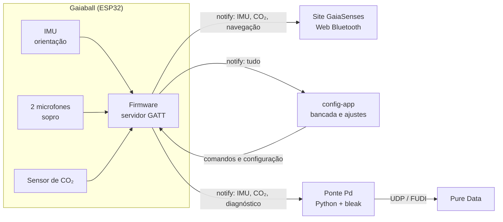
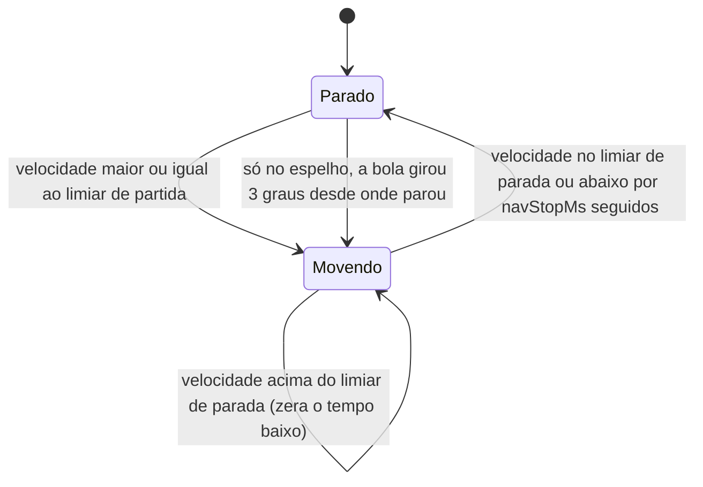
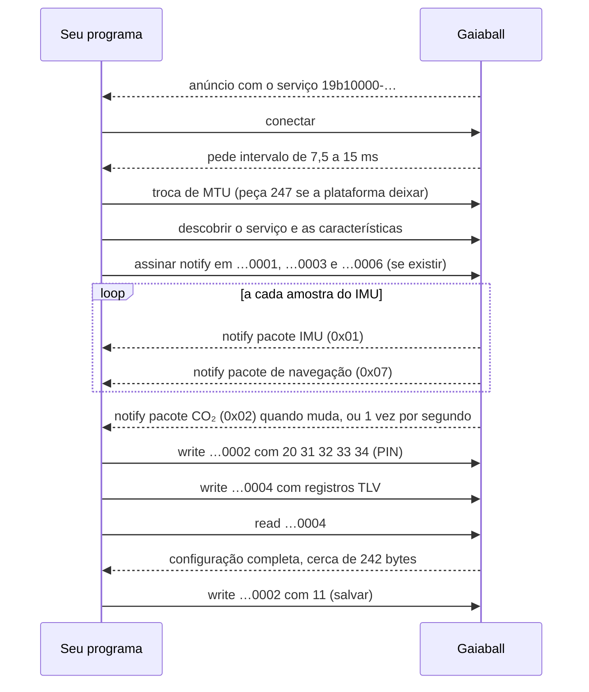

# Protocolo BLE da Gaiaball — guia didático

> **Duas cópias idênticas.** Este texto existe, byte a byte igual, em dois repositórios:
> `docs/protocolo-ble.md` no repositório da Gaiaball e `docs/gaiaball-protocolo-ble.md` no
> repositório do site GaiaSenses. A **versão de referência** é a da Gaiaball:
> <https://github.com/GaiaSenses/gaiaball/blob/main/docs/protocolo-ble.md>. Corrija lá e copie
> para o site. Todos os links para código são absolutos, para funcionarem nas duas cópias.
>
> A especificação curta, em inglês, para quem já conhece BLE é
> [`firmware/docs/protocol.md`](https://github.com/GaiaSenses/gaiaball/blob/main/firmware/docs/protocol.md).
> Este guia explica o mesmo protocolo do zero, com exemplos que rodam.

## Índice

1. [Visão geral](#visao-geral)
2. [BLE em poucas palavras](#ble-basico)
3. [Por que binário e não JSON](#por-que-binario)
4. [Conceitos para ler os bytes](#conceitos)
5. [Mapa GATT: o serviço e as seis características](#mapa-gatt)
6. [Os pacotes, byte a byte](#pacotes)
   - [Cabeçalho comum](#cabecalho) · [0x01 IMU](#pkt-imu) · [0x02 CO₂](#pkt-co2) ·
     [0x03 Diagnóstico](#pkt-diag) · [0x04 Sensores](#pkt-sensores) ·
     [0x05 Áudio cru](#pkt-audio) · [0x06 Magnetômetro cru](#pkt-mag) ·
     [0x07 Navegação](#pkt-nav)
7. [Navegação do globo](#navegacao)
8. [Escrevendo na bola: comandos, PIN e configuração](#escrita)
   - [Comandos](#comandos) · [PIN](#pin) · [Configuração TLV](#tlv) ·
     [Tabela completa de registradores](#tabela-tlv)
9. [Passo a passo para escrever um cliente](#passo-a-passo)
10. [Exemplos completos](#exemplos): [JavaScript](#exemplo-js) · [Python](#exemplo-python) ·
    [C portátil](#exemplo-c)
11. [Vetores de ouro (golden vectors)](#vetores)
12. [Compatibilidade e versionamento](#versionamento)
13. [Perguntas frequentes e solução de problemas](#faq)
14. [Onde está cada coisa no código](#referencias)

---

<a id="visao-geral"></a>

## Visão geral

A Gaiaball é um globo físico com um ESP32 dentro. Ela mede a própria **orientação** (um IMU:
giroscópio, acelerômetro e, opcionalmente, magnetômetro), o **som** de dois microfones (para
detectar sopro) e o **CO₂** do ambiente. Tudo isso sai da bola por **Bluetooth Low Energy
(BLE)**, em pacotes binários pequenos. A própria bola também calcula para onde o globo virtual
deve apontar (a **navegação**) e manda o resultado pronto.

Do outro lado podem estar três programas, até **dois ao mesmo tempo** (o firmware aceita duas
conexões simultâneas e recusa a terceira):



| Programa | O que faz com a bola | Escreve na bola? |
|---|---|---|
| **Site GaiaSenses** | Move o globo do Mapbox com a navegação, abre composições quando o CO₂ dispara, repassa orientação, aceleração e CO₂ aos patches de Pure Data | Não |
| **config-app** | Bancada: mostra tudo em gráficos, edita e salva a configuração, calibra | Sim (com PIN) |
| **Ponte Pd** (`pd-gaiaball/`) | Repassa orientação, aceleração, envelope dos microfones, CO₂, níveis e diagnóstico ao Pure Data | Não |
| **O seu programa** | O que você quiser: este guia mostra como | Opcional |

Ninguém precisa **parear** a bola: o firmware não usa pareamento nem criptografia de enlace.
Ler é livre; o que muda a bola (comandos e configuração) exige destravar a conexão com um
PIN de 4 dígitos.

---

<a id="ble-basico"></a>

## BLE em poucas palavras

Se você nunca usou Bluetooth Low Energy, estes são os únicos conceitos necessários.

**Periférico e central.** A bola é o **periférico**: ela fica anunciando que existe. O
computador, o celular ou o navegador é a **central**: ele procura, escolhe e conecta.

**Anúncio (advertising).** Enquanto há vaga, a bola transmite periodicamente "estou aqui, me
chamo `Globo_1` e tenho o serviço `19b10000-…`". É por esse serviço que um programa reconhece
uma Gaiaball no meio de outros aparelhos (o nome pode ser mudado na configuração).

**GATT: serviços e características.** Depois de conectar, a bola se apresenta como uma
pequena árvore, o **GATT** (*Generic Attribute Profile*). Pense num armário: o **serviço** é o
armário (a Gaiaball tem um só) e as **características** são as gavetas. Cada gaveta tem um
**UUID**, um identificador de 128 bits escrito como `19b10001-e8f2-537e-4f6c-d104768a1214`,
e um conjunto de **propriedades** que dizem o que se pode fazer com ela:

| Propriedade | Em palavras simples |
|---|---|
| **read** | Você pede e recebe o valor atual da gaveta, quando quiser. |
| **write** | Você coloca bytes na gaveta e recebe um "recebido" da camada ATT da bola (o NimBLE, a pilha BLE do firmware, só responde depois de entregar os bytes ao código da bola). Atenção: esse "recebido" só diz que os bytes **chegaram**, não que a bola **aceitou** o pedido. |
| **write without response** | Igual, mas sem o "recebido". Mais rápido, sem garantia. |
| **notify** | A bola **empurra** o valor novo sempre que ele muda, sem você pedir. Você precisa **assinar** (*subscribe*) primeiro; as bibliotecas fazem isso com `startNotifications()` (Web Bluetooth) ou `start_notify()` (bleak). |

Quase todos os dados da Gaiaball chegam por **notify**: você assina uma vez e passa a receber
dezenas de pacotes por segundo.

**MTU.** É o tamanho máximo de uma mensagem do protocolo de atributos (ATT) na conexão. O
padrão do BLE é **23 bytes**, dos quais 3 são cabeçalho, sobrando **20 bytes** de dados por
notificação. Os dois lados podem negociar um MTU maior logo após conectar; a Gaiaball aceita
até **247** (`NimBLEDevice::setMTU(247)`), mas quem pede a troca é a central. Uma regra
importante do BLE: **uma notificação leva no máximo MTU − 3 bytes; o que passar disso é
cortado.** Por isso cada pacote abaixo tem um "MTU mínimo". Leituras (*read*) são diferentes:
uma leitura longa é buscada em pedaços automaticamente pelas bibliotecas.

**Intervalo de conexão.** Central e periférico só conversam em "encontros" marcados, os
*connection events*. A Gaiaball pede encontros a cada **7,5 a 15 ms** (latência 0, *timeout*
de supervisão de 4 s); a central pode aceitar outro valor. O valor concedido aparece no
pacote de diagnóstico (`connItvlMsX10`). Ele limita quantas notificações por segundo cabem no
enlace: com encontros a cada 30 ms e uns 3 pacotes por encontro, o teto fica perto de 100 por
segundo, por mais rápido que a bola produza.

---

<a id="por-que-binario"></a>

## Por que binário e não JSON

O firmware original da bola ([`firmware-original.ino`](https://github.com/GaiaSenses/gaiaball/blob/main/firmware-original.ino))
mandava texto JSON. A cada leitura bem-sucedida do IMU no `loop()` ele enviava **duas**
notificações: uma com a orientação na característica `…0001` e outra com o CO₂ na `…0003`.
Uma amostra típica:

```json
{"quat":{"quat_w":0.924937802,"quat_x":0.1234567,"quat_y":-0.098765399,"quat_z":0.345678899},"euler":{"roll":-15.75707139,"pitch":9.212544369,"yaw":-42.26218349},"acc":{"x":-1520,"y":873,"z":7984}}
```

```json
{"co2":{"ppm":1200}}
```

A primeira tem **197 bytes**; a segunda, **20 bytes**.

> **Como esses tamanhos foram medidos.** O trecho do `loop()` que monta os dois documentos
> (linhas 537–617 do `.ino`) foi copiado para um programa de PC e compilado com a mesma
> biblioteca, ArduinoJson, nas versões 6.21.5 e 7.2.1 (o código antigo compila nas duas, e a
> amostra acima sai igual nas duas). A amostra é uma orientação inclinada com aceleração
> `(-1520, 873, 7984)`. Em 100 000 orientações e acelerações aleatórias, o JSON de orientação
> variou de **185 a 205 bytes, com média de 199**; o de CO₂ tem 19 ou 20 bytes (ppm com 3 ou
> 4 dígitos).

O pacote binário equivalente da versão atual tem **31 bytes** e ainda carrega quatro números
a mais (o envelope dos microfones). Em detalhe:

| | JSON (firmware original) | Binário v1 (firmware atual) |
|---|---|---|
| Bytes por amostra de orientação | ≈ 199 (185–205) **+** 20 do CO₂ a cada leitura | **31**, com som incluído; o CO₂ (12 B) só sai quando muda ou 1 vez por segundo |
| A 50 amostras por segundo | ≈ 11 kB/s | ≈ 1,6 kB/s |
| MTU mínimo para chegar inteiro | ≈ 208 | **34** |
| Pedaços de rádio por amostra, sem *Data Length Extension* (27 B por pedaço) | 8 (orientação) + 1 (CO₂) | **2** |
| Como o receptor lê | Varre texto, converte texto em número, cria objetos | Lê números em posições fixas |
| Valor inválido (NaN) | Vira `null` no meio do JSON | Flag `quatValid = 0`, explícita |
| Lixo, truncamento, versão errada | Exceção no `JSON.parse` ou campo `undefined` silencioso | Recusado na hora por versão, tipo e tamanho |

Os motivos, um por um:

1. **Tamanho e MTU.** Com o MTU padrão (20 bytes úteis), o JSON de orientação chegaria
   cortado em `{"quat":{"quat_w":0.` — os primeiros 20 caracteres, inúteis. Ele só funciona
   quando a central negocia um MTU de uns 208 bytes ou mais. O binário precisa de 34.
2. **Rádio.** Sem *Data Length Extension*, o enlace leva no máximo 27 bytes por pedaço.
   197 bytes de JSON + 7 de cabeçalhos (ATT e L2CAP) = 204 bytes = 8 pedaços; os 31 bytes do
   binário + 7 = 38 bytes = 2 pedaços. Menos pedaços por amostra deixam espaço para taxas
   maiores (até 200 amostras por segundo) e para a navegação no mesmo enlace.
3. **Custo de leitura.** Ler JSON exige percorrer cada caractere, converter texto decimal em
   número e alocar objetos novos a cada amostra, dezenas de vezes por segundo. No ESP32,
   escrever o JSON também custa: formatar 10 números com casas decimais como texto e montar
   `String`s na memória dinâmica. O binário é copiado e lido em posições fixas.
4. **Precisão do número em texto.** O texto `0.924937802` tem 11 caracteres e finge uma
   precisão (9 casas) que o sensor não tem. Outra biblioteca, ou um `float` em vez de
   `double`, escreveria outra quantidade de dígitos, e o receptor recebe sempre uma
   aproximação decimal, não o valor exato. No binário, o quaternião vai como inteiro de 2
   bytes em **ponto fixo Q14**: resolução de 1/16384 ≈ 0,00006 (cerca de 0,007° de ângulo),
   melhor que o ruído do sensor, e o receptor sabe exatamente qual inteiro foi enviado.
   Isso permite testar decodificadores **byte a byte** com [vetores de ouro](#vetores).
5. **Validação estrita.** Todo pacote começa com **versão** e **tipo**, e cada tipo tem
   tamanho conhecido. Um decodificador recusa em uma linha qualquer coisa que não seja o
   esperado. Com JSON, um campo que some vira `undefined` e o erro aparece longe dali.

**As desvantagens, com honestidade:**

- **Não é legível por humanos.** `01 01 02 01 0D 0C …` não diz nada sem a tabela ao lado.
  Para depurar é preciso um *dump* hexadecimal e esta documentação.
- **Precisa de especificação e de vetores de ouro.** Um erro de um byte no deslocamento
  (*offset*) produz números plausíveis e errados. Por isso existem os vetores de ouro, e os
  três decodificadores oficiais (firmware, config-app, site) são testados contra os mesmos
  bytes.
- **Disciplina de *endianness*.** Todo número de vários bytes é *little-endian*. Em
  JavaScript, `DataView.getInt16(offset)` **sem** o segundo argumento `true` lê
  *big-endian* e devolve lixo plausível. É o erro mais comum.
- **Regras de versão.** Acrescentar um campo exige cuidado: só no fim do pacote, nunca
  mudando o que já existe, e os decodificadores precisam aceitar pacotes maiores (veja
  [Compatibilidade e versionamento](#versionamento)). No JSON, um campo novo é ignorado de
  graça.

---

<a id="conceitos"></a>

## Conceitos para ler os bytes

### Little-endian, com um exemplo

Um número de 16 bits ocupa 2 bytes; um de 32 bits, 4. **Little-endian** quer dizer que o
byte **menos** significativo vem **primeiro**. Exemplo com o contador `seq = 258`:

```
258 em hexadecimal = 0x0102
na ordem little-endian = 02 01   (primeiro o byte baixo, 0x02; depois o alto, 0x01)
de volta: 0x02 + 0x01 × 256 = 2 + 256 = 258
```

Números negativos usam **complemento de dois**. Exemplo com a latitude do vetor de ouro A,
`latE7 = −229055560`, que chega como `B8 E3 58 F2`:

```
bytes na ordem recebida:   B8 E3 58 F2
montando do último ao 1º:  0xF258E3B8 = 4065911736   (lido como número sem sinal)
o bit mais alto é 1, então é negativo: 4065911736 − 2^32 = −229055560
−229055560 / 10 000 000 = −22,905556°   (latitude de Campinas)
```

Você não precisa fazer essa conta à mão: `DataView.getInt32(off, true)` em JavaScript,
`struct.unpack_from("<i", …)` em Python e as funções do [exemplo em C](#exemplo-c) fazem.

### Tipos inteiros

| Nome no protocolo | Bytes | Faixa | JavaScript (`DataView`) | Python (`struct`) | C (`stdint.h`) |
|---|---|---|---|---|---|
| `u8` | 1 | 0 a 255 | `getUint8` | `B` | `uint8_t` |
| `u16` | 2 | 0 a 65535 | `getUint16(o, true)` | `<H` | `uint16_t` |
| `i16` | 2 | −32768 a 32767 | `getInt16(o, true)` | `<h` | `int16_t` |
| `u32` | 4 | 0 a 4294967295 | `getUint32(o, true)` | `<I` | `uint32_t` |
| `i32` | 4 | −2147483648 a 2147483647 | `getInt32(o, true)` | `<i` | `int32_t` |

Os pacotes não têm bytes de preenchimento entre campos (*packed*): o campo seguinte começa
exatamente onde o anterior termina.

### Ponto fixo: números com vírgula dentro de inteiros

Para mandar um número fracionário sem usar `float`, o firmware multiplica por uma escala
fixa e manda o inteiro. O receptor divide pela mesma escala.

| Escala | Onde aparece | Exemplo no fio | Valor real |
|---|---|---|---|
| **Q14** (÷ 16384) | quaternião (`quatW…quatZ`) | `16384` (`00 40`) | 1,0 |
| **× 100** | rumo (`bearingX100`), níveis de som em dBFS, viés do giroscópio | `4500` | 45,00° |
| **× 10** | velocidade do globo (`speedDegSX10`), taxas em Hz, intervalo de conexão | `123` | 12,3 °/s |
| **E7** (× 10⁷) | latitude e longitude da navegação | `−229055560` | −22,905556° |
| **E6** (× 10⁶) | ponto de referência da navegação (registrador `0x62`) | `−22905556` | −22,905556° |

Os nomes dos campos dizem a escala: `X100` = vezes 100, `X10` = vezes 10, `E7` = vezes 10⁷.
Em E7, um passo vale cerca de 1 cm no equador.

### Flags: vários "sim/não" num byte

Um byte de **flags** guarda até 8 respostas sim/não, uma por bit. O bit 0 vale 1, o bit 1
vale 2, o bit 2 vale 4, o bit 3 vale 8. Para saber se o bit 3 está ligado:
`(flags & 0x08) !== 0`. Exemplo: `flags = 0x0B = 1 + 2 + 8` → bits 0, 1 e 3 ligados.
Bits que você não conhece devem ser **ignorados**: versões novas do firmware podem ligar
bits novos (o bit 3 do CO₂ nasceu assim).

### Número de sequência (`seq`) e perdas

Cada tipo de pacote tem o seu contador `seq` (`u16`), que soma 1 a cada pacote montado.
Depois de 65535 ele volta a 0. Se você recebeu `seq` 10 e depois 13, os pacotes 11 e 12 se
perderam (por exemplo, a fila do rádio estava cheia). A conta segura, que funciona na volta
65535 → 0, é:

```
delta = (seq_atual − seq_anterior) & 0xFFFF     # 0 → repetido; 1 → nada perdido
perdidos += delta − 1                           # quando delta ≥ 2
```

O contador **não** recomeça a cada conexão (só quando a bola reinicia), e alguns pacotes
contam mesmo sem ninguém assinando. Então: zere o seu acompanhamento a cada conexão e não
conte o primeiro salto como perda.

### Carimbos de tempo (*timestamps*)

Todo pacote traz um tempo de 32 bits sem sinal, contado no relógio da bola desde que ela
ligou:

| Campo | Unidade | Dá a volta depois de |
|---|---|---|
| `timestampUs` (IMU, navegação) | microssegundos | 2³² µs ≈ 71,6 minutos |
| `timestampMs` (CO₂, sensores, áudio, magnetômetro) | milissegundos | 2³² ms ≈ 49,7 dias |
| `uptimeS` (diagnóstico) | segundos | — |

Use o tempo da bola para medir **intervalos entre pacotes**, não para saber a hora do dia.
A diferença segura, que sobrevive à volta, é `(t − t_anterior) mod 2³²`: em JavaScript,
`(t - tAnterior) >>> 0`; em Python, `(t - t_anterior) & 0xFFFFFFFF`.

---

<a id="mapa-gatt"></a>

## Mapa GATT: o serviço e as seis características

Serviço: **`19b10000-e8f2-537e-4f6c-d104768a1214`**

| # | UUID | Propriedades | Conteúdo | Quando chega |
|---|---|---|---|---|
| 1 | `19b10001-e8f2-537e-4f6c-d104768a1214` | notify, read | Pacote IMU (`0x01`) | `imuNotifyHz` vezes por segundo (10–200, padrão 50), só enquanto alguém assina |
| 2 | `19b10002-e8f2-537e-4f6c-d104768a1214` | write, write without response | Comandos (opcode + argumentos) | Quando você escreve |
| 3 | `19b10003-e8f2-537e-4f6c-d104768a1214` | notify, read | Pacote CO₂ (`0x02`) | Na hora em que ppm ou flags mudam (conferido a cada 50 ms); sem mudança, 1 vez por segundo |
| 4 | `19b10004-e8f2-537e-4f6c-d104768a1214` | read, write | Configuração em TLV | Quando você lê ou escreve |
| 5 | `19b10005-e8f2-537e-4f6c-d104768a1214` | notify, read | Vários tipos: `0x03` diagnóstico (1 Hz), `0x04` sensores (5 Hz), `0x05` áudio cru (~21 Hz, só se ligado), `0x06` magnetômetro cru (~3 Hz, só durante a captura) | Conforme o tipo |
| 6 | `19b10006-e8f2-537e-4f6c-d104768a1214` | notify, read | Pacote de navegação (`0x07`) | A cada N amostras do IMU (veja [Navegação](#navegacao)); 1 vez por segundo como *keepalive* quando não há pose |

Três regras valem para todas:

- **A característica 6 é opcional para os clientes.** Firmware anterior à navegação não a
  tem. Se ela não existir, trate como "navegação não suportada" e continue com as outras.
- **A característica 5 mistura tipos.** Olhe o byte 1 (tipo) de cada notificação e decida o
  que fazer; ignore tipos que você não conhece.
- **Ler uma característica de notify** (*read*) devolve o último pacote enviado por notify,
  ou só zeros se nenhum foi enviado desde o boot (a 6, por exemplo, devolve 22 bytes
  zerados). Um pacote zerado tem versão 0 e é recusado por um decodificador correto.

---

<a id="pacotes"></a>

## Os pacotes, byte a byte

<a id="cabecalho"></a>

### Cabeçalho comum

Os 8 primeiros bytes de **todos** os pacotes têm a mesma forma:

| Offset | Tam. | Tipo | Campo | Significado |
|---|---|---|---|---|
| 0 | 1 | u8 | `version` | Versão do protocolo: sempre **1** |
| 1 | 1 | u8 | `type` | Tipo do pacote: `0x01` a `0x07` |
| 2 | 2 | u16 | `seq` | Contador deste tipo de pacote |
| 4 | 4 | u32 | tempo | `timestampUs`, `timestampMs` ou `uptimeS`, conforme o tipo |

Resumo dos tipos (o "MTU mínimo" é o tamanho + 3 bytes do cabeçalho ATT):

| Tipo | Nome | Tamanho | MTU mínimo | Característica |
|---|---|---|---|---|
| `0x01` | IMU (orientação + aceleração + som) | 31 B | 34 | 1 |
| `0x02` | CO₂ | 12 B | 15 | 3 |
| `0x03` | Diagnóstico | 34 B | 37 | 5 |
| `0x04` | Sensores (níveis de áudio e potenciômetro) | 23 B | 26 | 5 |
| `0x05` | Áudio cru | 208 B | 211 | 5 |
| `0x06` | Magnetômetro cru | 106 B | 109 | 5 |
| `0x07` | Navegação | 22 B | 25 | 6 |

<a id="pkt-imu"></a>

### IMU — tipo `0x01`, 31 bytes

A orientação da bola, a aceleração e o som dos microfones, todos do mesmo instante.

| Offset | Tam. | Tipo | Campo | Unidade / escala | Significado |
|---|---|---|---|---|---|
| 0 | 1 | u8 | `version` | — | 1 |
| 1 | 1 | u8 | `type` | — | `0x01` |
| 2 | 2 | u16 | `seq` | — | Contador de pacotes IMU |
| 4 | 4 | u32 | `timestampUs` | µs | Instante da amostra |
| 8 | 2 | i16 | `quatW` | Q14 (÷ 16384) | Quaternião, parte real |
| 10 | 2 | i16 | `quatX` | Q14 | Quaternião, x |
| 12 | 2 | i16 | `quatY` | Q14 | Quaternião, y |
| 14 | 2 | i16 | `quatZ` | Q14 | Quaternião, z |
| 16 | 2 | i16 | `accX` | contagens (÷ 8192 = g) | Aceleração x |
| 18 | 2 | i16 | `accY` | contagens | Aceleração y |
| 20 | 2 | i16 | `accZ` | contagens | Aceleração z |
| 22 | 1 | u8 | `flags` | bits | Veja abaixo |
| 23 | 2 | i16 | `audioRmsDbX100[0]` | dBFS × 100 | RMS do microfone esquerdo |
| 25 | 2 | i16 | `audioRmsDbX100[1]` | dBFS × 100 | RMS do microfone direito |
| 27 | 2 | i16 | `audioPeakDbX100[0]` | dBFS × 100 | Pico do microfone esquerdo |
| 29 | 2 | i16 | `audioPeakDbX100[1]` | dBFS × 100 | Pico do microfone direito |

**Flags:**

| Bit | Valor | Nome | Ligado quando |
|---|---|---|---|
| 0 | `0x01` | `quatValid` | O quaternião é válido. Desligado (falha numérica na fusão), o quaternião é a última orientação boa ou a identidade e não deve ser usado. |
| 1 | `0x02` | `nineAxis` | O modo Quat9 está ativo (fusão com magnetômetro). |
| 2 | `0x04` | `moving` | A orientação mudou mais de 0,25° desde a amostra anterior. |
| 3 | `0x08` | `audioValid` | Os quatro níveis de som valem. Desligado, todos leem −120,00 dBFS. |

- **Orientação.** É a orientação **tratada**: já com a calibração de montagem, o zero e os
  filtros configurados. A fusão (filtro de Madgwick) roda no ESP32.
- **Aceleração.** Contagens cruas do IMU em ±4 g: divida por 8192 para ter g. Os filtros de
  aceleração (registradores `0x04` e `0x1D`) agem antes do envio, na mesma escala.
- **Som.** Medido no firmware numa janela de 20 ms que termina nesta amostra (o pico é
  acompanhado nos 16 kHz completos). RMS em dBFS AES17 (0 dBFS = senoide de fundo de escala);
  pico em dBFS de amplitude (0 dBFS = amostra de fundo de escala). A mesma senoide aparece
  3,01 dB mais baixa no pico. Faixa no fio: −12000 (−120,00 dBFS) a 6000 (+60,00).
- **Taxa:** `imuNotifyHz` (registrador `0x02`, 10–200, padrão 50). **MTU mínimo:** 34.

<a id="pkt-co2"></a>

### CO₂ — tipo `0x02`, 12 bytes

| Offset | Tam. | Tipo | Campo | Unidade / escala | Significado |
|---|---|---|---|---|---|
| 0 | 1 | u8 | `version` | — | 1 |
| 1 | 1 | u8 | `type` | — | `0x02` |
| 2 | 2 | u16 | `seq` | — | Contador de pacotes CO₂ |
| 4 | 4 | u32 | `timestampMs` | ms | Instante do envio |
| 8 | 2 | u16 | `ppm` | ppm | CO₂ informado (veja abaixo) |
| 10 | 1 | u8 | `flags` | bits | Veja abaixo |
| 11 | 1 | u8 | `ageS` | s | Idade da última leitura do sensor; **255** = nenhuma leitura desde o boot (ou 255 s ou mais) |

**Flags:**

| Bit | Valor | Nome | Ligado quando |
|---|---|---|---|
| 0 | `0x01` | `valid` | O sensor está habilitado e a leitura é recente. |
| 1 | `0x02` | `stale` | Nenhuma leitura do sensor há mais de `co2StaleTimeoutMs` (padrão 5000 ms), ou nunca. |
| 2 | `0x04` | `virtualActive` | Um **pulso virtual** está ativo: um sopro detectado pelos microfones simula um pico de CO₂. |
| 3 | `0x08` | `trigger` | **Gatilho**: o ppm passou do limite configurado, com histerese (veja abaixo). |

- **De onde vem o `ppm`.** Durante um pulso virtual, é o pico configurado (`virtualPeakPpm`,
  padrão 2100). Fora dele, é a leitura real se o sensor está habilitado (`co2Enabled` ≠ 0); com
  o sensor desabilitado (`co2Enabled` = 0), é a constante **600** (o valor "normal" do
  firmware original), e `valid` fica desligado.
- **O pulso virtual.** Um sopro agenda o pulso para daqui a `virtualDelayMs` (padrão
  1000 ms); ele dura `virtualHoldMs` (padrão 17000 ms).
- **O gatilho (`trigger`).** É um nível com histerese calculado **na bola**, sobre o ppm
  informado (o pulso virtual conta). Ele **liga** quando `ppm > co2TriggerPpm` (padrão 1200) e
  **desliga** quando `ppm ≤ co2TriggerPpm − co2TriggerHystPpm` (padrão 1200 − 50 = 1150; se a
  histerese for maior ou igual ao limite, desliga só em 0). Com a leitura `stale`, o gatilho é
  forçado a desligar, **a menos que** o pulso virtual esteja ativo (aí é o pulso que fornece
  o ppm). Uma virada do gatilho muda as flags, então o pacote sai na hora. O site usa só
  essa borda: 0 → 1 abre uma composição, 1 → 0 fecha.
- **Taxa:** imediata quando ppm ou flags mudam (o firmware confere a cada 50 ms), senão 1 vez
  por segundo. O sensor físico produz uma leitura por segundo. **MTU mínimo:** 15.

<a id="pkt-diag"></a>

### Diagnóstico — tipo `0x03`, 34 bytes (característica 5)

Saúde da bola, 1 vez por segundo. Útil para bancada e para descobrir por que algo está lento.

| Offset | Tam. | Tipo | Campo | Unidade / escala | Significado |
|---|---|---|---|---|---|
| 0 | 1 | u8 | `version` | — | 1 |
| 1 | 1 | u8 | `type` | — | `0x03` |
| 2 | 2 | u16 | `seq` | — | Contador |
| 4 | 4 | u32 | `uptimeS` | s | Tempo desde que a bola ligou |
| 8 | 2 | u16 | `imuHzX10` | Hz × 10 | Taxa de amostragem medida do IMU |
| 10 | 2 | u16 | `notifyHzX10` | Hz × 10 | Pacotes IMU enviados por segundo, medido |
| 12 | 2 | u16 | `fifoOverflows` | contagem | Nome histórico: hoje conta erros de leitura I²C do IMU |
| 14 | 2 | u16 | `i2sErrors` | contagem | Erros do I²S (microfones) |
| 16 | 2 | u16 | `uartFrameErrors` | contagem | Quadros com erro vindos do sensor de CO₂ |
| 18 | 2 | u16 | `freeHeapKb` | KiB | Memória livre agora |
| 20 | 2 | u16 | `minFreeHeapKb` | KiB | Menor memória livre desde o boot |
| 22 | 1 | u8 | `flags` | bits | bit0 `imuOk`, bit1 `audioOk`, bit2 `co2Ok` |
| 23 | 1 | u8 | `ahrsFlags` | bits | Estado da fusão, veja abaixo |
| 24 | 1 | u8 | `accelErrDeg` | ° (0–90) | Discordância entre a inclinação estimada e a medida |
| 25 | 1 | u8 | `magErrDeg` | ° (0–90) | Discordância entre o rumo estimado e o medido |
| 26 | 2 | i16 | `gyroBiasX100[0]` | °/s × 100 | Viés estimado do giroscópio, x |
| 28 | 2 | i16 | `gyroBiasX100[1]` | °/s × 100 | Viés estimado, y |
| 30 | 2 | i16 | `gyroBiasX100[2]` | °/s × 100 | Viés estimado, z |
| 32 | 2 | u16 | `connItvlMsX10` | ms × 10 | Intervalo de conexão concedido; 0 = desconhecido |

`ahrsFlags`: bit0 `startup` (ganho ainda caindo após o início), bit1 `overrange` (giroscópio
saturou, filtro reiniciado), bit2 `accelIgnored` (acelerômetro sendo ignorado agora), bit3
`magIgnored` (magnetômetro sendo ignorado agora), bit4 `biasAtRest` (bola parada para o
estimador de viés), bit5 `biasAdapting` (viés sendo refinado), bit6 `magCalibrated`
(calibração do magnetômetro carregada), bit7 `magCapture` (captura crua em andamento).
**MTU mínimo:** 37.

<a id="pkt-sensores"></a>

### Sensores — tipo `0x04`, 23 bytes (característica 5)

Níveis de áudio e do potenciômetro, 5 vezes por segundo, para os gráficos da config-app.

| Offset | Tam. | Tipo | Campo | Unidade / escala | Significado |
|---|---|---|---|---|---|
| 0 | 1 | u8 | `version` | — | 1 |
| 1 | 1 | u8 | `type` | — | `0x04` |
| 2 | 2 | u16 | `seq` | — | Contador |
| 4 | 4 | u32 | `timestampMs` | ms | Instante do envio |
| 8 | 4 | u32 | `audioRmsL` | contagens de 24 bits | RMS do microfone esquerdo |
| 12 | 4 | u32 | `audioRmsR` | contagens de 24 bits | RMS do microfone direito |
| 16 | 4 | u32 | `audioThreshold` | contagens de 24 bits | Limiar do detector de sopro |
| 20 | 2 | u16 | `potRaw` | 0–4095 | Potenciômetro (ADC de 12 bits, filtrado) |
| 22 | 1 | u8 | `flags` | bits | bit0 `audioOk`, bit1 `audioEnabled`, bit2 `potControlsThreshold`, bit3 `audioFiltered` (RMS medido depois do passa-banda) |

Conversões: `dBFS = 20·log10(rms·√2 / 2²³)` (2²³ = 8388608 é o fundo de escala); percurso do
potenciômetro em % = `potRaw / 4095 × 100`. **MTU mínimo:** 26.

<a id="pkt-audio"></a>

### Áudio cru — tipo `0x05`, 208 bytes (característica 5, só se ligado)

Amostras de áudio para o analisador de espectro da config-app (a FFT roda no navegador).
Mono (média de esquerdo e direito), sem componente contínua, reduzido de 16 kHz para 2 kHz
por média de 8 amostras. **Desligado por padrão:** só sai enquanto o registrador `0x1F`
(`audioRawStream`) vale 1 **e** alguém assina a característica 5. Ligado, ele sozinho ocupa
cerca de 4,3 kB/s, mais que todo o resto junto.

| Offset | Tam. | Tipo | Campo | Unidade / escala | Significado |
|---|---|---|---|---|---|
| 0 | 1 | u8 | `version` | — | 1 |
| 1 | 1 | u8 | `type` | — | `0x05` |
| 2 | 2 | u16 | `seq` | — | Contador |
| 4 | 4 | u32 | `timestampMs` | ms | Instante do envio |
| 8 | 2 | u16 | `sampleRateHz` | Hz | 2000 |
| 10 | 1 | u8 | `count` | — | 96 amostras |
| 11 | 1 | u8 | `flags` | bits | bit0 = passa-banda ligado (as amostras são cruas de qualquer jeito) |
| 12 | 2 | u16 | `hpHz` | Hz | Passa-altas configurado (eco, para a interface) |
| 14 | 2 | u16 | `lpHz` | Hz | Passa-baixas configurado (eco) |
| 16 | 192 | i16[96] | `samples` | 16 bits mais altos da amostra de 24 bits | Áudio |

96 amostras a 2 kHz = 48 ms por pacote, cerca de 20,8 pacotes por segundo. **MTU mínimo:**
211.

<a id="pkt-mag"></a>

### Magnetômetro cru — tipo `0x06`, 106 bytes (característica 5, só durante a captura)

Amostras **sem calibração** do magnetômetro, para a config-app calcular a calibração
(*hard/soft iron*). Só saem entre os comandos `0x15` (iniciar) e `0x16` (parar), param
sozinhas depois de 180 s e só existem no modo Quat9 (no Quat6 o magnetômetro não é lido).

| Offset | Tam. | Tipo | Campo | Unidade / escala | Significado |
|---|---|---|---|---|---|
| 0 | 1 | u8 | `version` | — | 1 |
| 1 | 1 | u8 | `type` | — | `0x06` |
| 2 | 2 | u16 | `seq` | — | Contador |
| 4 | 4 | u32 | `timestampMs` | ms | Instante do envio |
| 8 | 1 | u8 | `count` | — | Amostras válidas, 0–16 |
| 9 | 1 | u8 | `flags` | bits | bit0 `calibrated` (sempre 0 na captura) |
| 10 | 96 | i16[48] | `samples` | 0,1 µT | x, y, z intercalados; além de `count`, zeros |

As amostras já vêm no referencial do acelerômetro/giroscópio, pelo remapeamento de eixos do
registrador `0x36`. Com o IMU a 50 Hz e 16 amostras por pacote, são cerca de 3 pacotes por
segundo. **MTU mínimo:** 109.

<a id="pkt-nav"></a>

### Navegação — tipo `0x07`, 22 bytes (característica 6)

A pose do globo virtual, **calculada na bola**: para onde o centro da tela aponta e como o
mapa está girado. Detalhes de uso em [Navegação do globo](#navegacao).

| Offset | Tam. | Tipo | Campo | Unidade / escala | Significado |
|---|---|---|---|---|---|
| 0 | 1 | u8 | `version` | — | 1 |
| 1 | 1 | u8 | `type` | — | `0x07` |
| 2 | 2 | u16 | `seq` | — | Contador de pacotes de navegação |
| 4 | 4 | u32 | `timestampUs` | µs | Instante da amostra do IMU que gerou a pose |
| 8 | 1 | u8 | `mode` | — | 0 desligado, 1 espelho, 2 joystick |
| 9 | 1 | u8 | `flags` | bits | Veja abaixo |
| 10 | 4 | i32 | `latE7` | graus × 10⁷ | Latitude do centro da tela, −90 a 90 |
| 14 | 4 | i32 | `lonE7` | graus × 10⁷ | Longitude do centro da tela, (−180, 180] |
| 18 | 2 | i16 | `bearingX100` | graus × 100 | Rumo no padrão do Mapbox, (−180, 180]; pelo arredondamento pode chegar −18000 (−180,00°) |
| 20 | 2 | u16 | `speedDegSX10` | °/s × 10 | Velocidade informada do globo; satura em 65535 (6553,5 °/s) |

**Flags:**

| Bit | Valor | Nome | Significado |
|---|---|---|---|
| 0 | `0x01` | `valid` | A pose é viva (a orientação do IMU é válida). **0 no *keepalive*.** |
| 1 | `0x02` | `settled` | O globo está **parado**. É a **autoridade** para "parou". |
| 2 | `0x04` | `moving` | Instantâneo: a velocidade informada está acima do limiar de parada. Só informativo. |

`moving` **não** é o contrário de `settled`. No modo espelho a velocidade pode ficar entre
os dois limiares (parada e partida) com a máquina ainda "parada", então `flags = 0x07`
(`valid + settled + moving`) é um valor legal. No espelho, a máquina também sai de "parado"
por um giro lento de 3° (veja [a máquina de estados](#nav-parado)), mesmo
abaixo do limiar de partida. No modo joystick a velocidade informada é 0
enquanto parado, então `moving` nunca liga junto com `settled`. **MTU mínimo:** 25.

---

<a id="navegacao"></a>

## Navegação do globo

### Os três modos

O modo é o registrador `navMode` (`0x60`) e vem também em cada pacote (`mode`).

| Valor | Modo | O que acontece |
|---|---|---|
| 0 | **Desligado** | Nenhuma pose. A bola manda só o *keepalive* (`valid = 0`) 1 vez por segundo. |
| 1 | **Espelho** (padrão) | O globo copia a orientação da bola: gire a bola e o globo gira junto. |
| 2 | **Joystick** | A inclinação da bola **comanda uma velocidade**: incline e o globo viaja; quanto mais inclinar, mais rápido; volte ao zero e ele para. |

No joystick, se a bola está inclinada de um ângulo θ em torno de um eixo u (em relação ao
zero), o globo gira em torno do mesmo eixo u com velocidade

```
S(θ) = joyMaxSpeedDegS · min(θ / joyFullAngleDeg, 1) ^ (joyCurveX10 / 10)     [°/s]
```

Com os padrões (90 °/s, 60°, curva 3,0 = cúbica): inclinar 30° dá 90 · 0,5³ = 11,25 °/s;
inclinar 60° ou mais dá 90 °/s. A curva cúbica deixa os movimentos pequenos bem finos.

### Referenciais e convenções

- **Referencial da bola** (depois de zerar com o comando `0x10`): **X é a "frente" da bola**
  (o nariz do aviãozinho na vista 3D da config-app) e aponta **para a pessoa que a usa**;
  **Z é para cima**; **Y é a esquerda da bola, que é a direita de quem usa** (sistema
  destro).
- **Referencial do globo** (esfera de raio 1): x aponta para (lat 0, lon 0), y para
  (lat 0, lon 90° leste) e z para o polo norte.
- **Orientação identidade = ponto de referência no centro, com o norte para cima.** O ponto
  de referência é o registrador `navRef` (`0x62`); o padrão é Campinas/SP, lat −22,905556,
  lon −47,060833. Logo depois de zerar, a bola mostra esse ponto no centro da tela com rumo 0.
- **Rumo (*bearing*)**: convenção do Mapbox, graus no sentido horário a partir do norte, da
  direção que aponta **para cima na tela**, normalizado em (−180, 180].

### Usando lat, lon e rumo diretamente

O pacote já traz exatamente o que um mapa precisa. Com o Mapbox GL JS:

```js
// nav = pacote de navegação decodificado (veja os exemplos)
if (nav.valid) {
  map.jumpTo({ center: [nav.lon, nav.lat], bearing: nav.bearing }); // atenção: [lon, lat]
}
```

O site GaiaSenses faz assim
([`use-ble-sensor.ts`](https://github.com/GaiaSenses/Gaiasenses-web/blob/main/app/%5Blocale%5D/map3/use-ble-sensor.ts)):
a cada pacote válido com `settled = 0`, chama `jumpTo`; quando `settled` passa de 0 para 1
depois de algum movimento, aplica a pose final uma vez e abre o clima do lugar onde o globo
parou. Um *keepalive* (`valid = 0`) zera esse acompanhamento, para um movimento antigo não
virar uma parada depois de uma queda de sinal. O primeiro pacote parado depois de conectar
(ou depois de um *keepalive*) sincroniza: leva o globo à pose da bola uma vez e abre o clima
desse lugar, mesmo que a bola não tenha se mexido.

O Mapbox não aceita centro além de cerca de **±85,05°** de latitude. O pacote traz a pose
verdadeira até ±90°; limitar perto dos polos é decisão do cliente.

<a id="nav-parado"></a>

### "Parado": a máquina de estados



| | Espelho (`navMode` 1) | Joystick (`navMode` 2) |
|---|---|---|
| Velocidade observada | Velocidade angular **medida** do globo, numa janela de ~100 ms | Velocidade **comandada** S(θ) |
| Limiar de partida | `navStartDegS` (padrão 20 °/s) | `joyStartDegSX10` ÷ 10 (padrão 1,0 °/s) |
| Limiar de parada | `navStopDegS` (padrão 5 °/s) | `joyStopDegSX10` ÷ 10 (padrão 0,5 °/s) |
| Tempo abaixo do limiar para parar | `navStopMs` (padrão 420 ms) | `navStopMs` (padrão 420 ms) |
| Velocidade no pacote | A medida | S(θ); **0 enquanto parado** |
| Enquanto parado | O globo segue a bola normalmente | O globo **congela** (não é integrado) |
| Sai de "parado" também | Por um giro de **3°** a partir da pose em que parou, mesmo devagar | Não |

No espelho, a velocidade é o ângulo entre a pose atual e a pose de **pelo menos 100 ms
antes**, dividido pelo tempo real entre as duas (logo depois de uma volta ao ponto de
referência, a bola usa a pose mais antiga que tiver). De uma amostra para a seguinte, o
tremor da mão (8–12 Hz) parece movimento acima do limiar de parada; na janela de 100 ms ele
se cancela, e a bola na mão consegue ficar "parada". A janela também atrasa em até
100 ms a queda da velocidade quando a bola para, antes de começar a contar o `navStopMs`.

Ainda no espelho, um giro lento e deliberado, abaixo de `navStartDegS`, nunca passaria do
limiar de partida. Por isso, enquanto está parada, a bola guarda a pose do momento em que
parou e volta a "em movimento" quando se afasta **3°** dela, qualquer que seja a velocidade.
A pose é capturada de novo a cada parada. Os 3° são uma constante do firmware, provisória,
a ajustar na bancada. O joystick não tem essa regra.

O joystick usa a velocidade **comandada** porque o globo fica congelado enquanto parado: a
velocidade dele mesmo nunca conseguiria fazê-lo partir de novo.

### Taxa, *keepalive* e quando o globo volta ao ponto de referência

- **Taxa.** A bola manda um pacote a cada **N** amostras do IMU, com
  **N = max(1, round(imuNotifyHz / navNotifyHz))** (arredondando metade para cima). Como N é
  inteiro, a taxa real é `imuNotifyHz / N` e nunca passa da taxa do IMU:

  | `imuNotifyHz` | `navNotifyHz` | N | Pacotes de navegação por segundo |
  |---|---|---|---|
  | 50 | 50 | 1 | 50 |
  | 100 | 50 | 2 | 50 |
  | 200 | 50 | 4 | 50 |
  | 50 | 20 | 3 | ≈ 16,7 |
  | 50 | 200 | 1 | 50 |

- ***Keepalive*.** Quando `navMode = 0`, ou quando nenhuma amostra do IMU chegou há mais de
  **500 ms** (IMU não configurado, sensor travado, ou ainda nenhuma amostra desde o boot), a
  bola manda **1 vez por segundo** um pacote com `valid = 0`, `mode` = o modo atual e todos
  os campos de pose zerados. Como todo pacote de navegação, ele só sai se alguém assina a
  característica 6.
- **Parâmetros ao vivo.** Mudar a lei do joystick (`0x63`–`0x65`), os limiares e o tempo de
  parada (`0x66`–`0x6A`) ou as taxas vale na hora e **não** mexe no globo.
- **Volta ao ponto de referência** (globo na identidade, estado parado, primeira amostra sem
  velocidade) acontece **só** quando muda o `navMode`, muda o `navRef`, ou muda a
  referência do IMU: **zerar** (`0x10`), **calibrar a montagem** (`0x14`) ou trocar entre
  **Quat6 e Quat9** (`orientationMode`).
- **O zero não é salvo.** Depois de desligar e ligar, zere de novo (comando `0x10` com a
  bola na posição "frente para a pessoa").

---

<a id="escrita"></a>

## Escrevendo na bola: comandos, PIN e configuração

**A bola nunca responde ao que recebe.** Um comando (característica 2) ou uma escrita de
configuração (característica 4) não gera resposta nenhuma. Uma escrita recusada (conexão não
destravada, valor fora da faixa, registrador desconhecido) é **descartada em silêncio**: a
escrita ATT em si dá certo, porque os bytes chegaram. Para saber o que valeu, **leia a
característica 4 de volta**. Para guardar na memória permanente, mande o comando `0x11`.

<a id="comandos"></a>

### Comandos — característica 2 (`…0002`)

Um comando é um byte de **opcode**, às vezes seguido de argumentos.

| Opcode | Precisa de PIN? | O que faz |
|---|---|---|
| `0x00`, `0x01` | — | Reservados (comando de LED do firmware antigo, removido). Ignorados; não reutilize. |
| `0x10` | sim | **Zerar a orientação.** Também volta o globo ao ponto de referência. Não é salvo: vale até a bola desligar. |
| `0x11` | sim | **Salvar** a configuração atual na memória permanente (NVS). |
| `0x12` | sim | **Restaurar o padrão de fábrica** e reiniciar. |
| `0x13` | sim | **Reiniciar.** |
| `0x14` | sim | **Calibrar a montagem** (com a bola na posição de referência). Limpa o zero e volta o globo ao ponto de referência. A montagem é gravada na memória na hora, e com ela a configuração atual inteira. |
| `0x15` | sim | Iniciar a captura crua do magnetômetro (pacotes `0x06`; para sozinha depois de 180 s; só no Quat9). |
| `0x16` | sim | Parar a captura do magnetômetro. |
| `0x20` + 4 dígitos ASCII | — | **Destravar** a conexão com o PIN (veja abaixo). |

Qualquer outro opcode é ignorado.

<a id="pin"></a>

### PIN: destravando a conexão

Para destravar, escreva na característica 2 o byte `0x20` seguido dos 4 dígitos do PIN em
ASCII. Com o PIN de fábrica `1234`:

```
20 31 32 33 34        (0x31 = '1', 0x32 = '2', 0x33 = '3', 0x34 = '4')
```

- O destravamento vale **para aquela conexão**, até ela cair. Ao reconectar, destrave de novo.
- Errar **5 vezes seguidas** bloqueia os pedidos daquela conexão por **30 s** contados da
  última falha; durante o bloqueio, até o PIN certo é recusado. Passados os 30 s, a contagem
  de falhas **continua** (5 ou mais): a próxima tentativa é comparada, e se errar começa outro
  bloqueio de 30 s na hora. Só um acerto ou uma desconexão zera a contagem.
- Ler a configuração e assinar notificações **não** precisa de PIN.
- Para trocar o PIN, escreva o registrador `0x41` (4 dígitos ASCII) e salve com `0x11`. O PIN
  nunca aparece na leitura da configuração.

<a id="tlv"></a>

### Configuração TLV — característica 4 (`…0004`)

Toda a configuração da bola é uma lista de **registradores**. Cada registrador viaja num
**registro TLV** (*type–length–value*, tipo–tamanho–valor):

```
┌────────┬────────┬───────────────────────────────┐
│   id   │  len   │  valor: len bytes             │
│   u8   │   u8   │  números em little-endian     │
└────────┴────────┴───────────────────────────────┘
```

Uma leitura ou escrita é simplesmente vários registros colados um atrás do outro.

**Ler** (sem PIN) devolve **todos** os registradores, mais o registrador somente-leitura
`0x35`: cerca de 242 bytes com o nome de fábrica. Isso é mais que um MTU, mas o Web
Bluetooth, o bleak e o NimBLE buscam a leitura longa em pedaços sozinhos. Um trecho da
leitura de fábrica:

```
60 01 01                         navMode     = 1 (espelho)
61 01 32                         navNotifyHz = 0x32 = 50
62 08 2C 7D A2 FE 9F E8 31 FD    navRef      = latE6 −22905556, lonE6 −47060833
63 02 5A 00                      joyMaxSpeedDegS = 0x005A = 90
```

Ao ler, percorra os registros pelo `len`: assim um registrador que você não conhece é
simplesmente pulado.

**Escrever** (com a conexão destravada) aceita **qualquer subconjunto** de registradores, em
qualquer ordem. Exemplos (conferidos com o código de validação do firmware compilado no PC):

| Bytes escritos | Efeito |
|---|---|
| `60 01 02` | `navMode` = 2 (joystick) |
| `29 02 DC 05` | `co2TriggerPpm` = 0x05DC = 1500 |
| `62 08 C8 A5 98 FE A4 6E 38 FD` | `navRef` = São Paulo (latE6 −23550520, lonE6 −46633308) |
| `66 01 28 67 01 19` | `navStartDegS` = 40 **e** `navStopDegS` = 25, juntos: aceito |
| `67 01 19` | Só `navStopDegS` = 25, com `navStartDegS` ainda 20: **recusado** (regra cruzada) |
| `60 01 02 61 01 05` | **Tudo recusado**: `navNotifyHz` = 5 está fora da faixa 10–200, então nem o `navMode` muda |
| `29 01 DC` | Recusado: `co2TriggerPpm` é u16 e precisa de `len` 2 |

**Regras de validação** (a escrita inteira é recusada se qualquer uma falhar — **tudo ou
nada**):

1. Todo `id` precisa existir na tabela. Um id desconhecido derruba a escrita inteira; isso
   inclui o `0x35`, que é só de leitura: **nunca** o inclua numa escrita.
2. O `len` precisa bater com o tipo: 1 para u8, 2 para u16, 4 para u32, 24 para `0x1E`, 8
   para `0x62`, 4 para o PIN, 1 a 16 para o nome. Um registro cortado no fim também derruba
   tudo.
3. O valor precisa estar na faixa (tabela abaixo).
4. **Regras cruzadas**, conferidas sobre o estado **resultante** (o que já está na bola
   combinado com o que você escreveu):
   - `soundLedPin` (`0x30`) ≠ `co2LedPin` (`0x31`): um pino, uma função;
   - `audioLpHz` (`0x19`) > `audioHpHz` (`0x17`): o passa-banda precisa ser uma banda;
   - `navStopDegS` (`0x67`) < `navStartDegS` (`0x66`);
   - `joyStopDegSX10` (`0x6A`) < `joyStartDegSX10` (`0x69`).

   Para mudar uma metade de um par para além da outra, escreva as duas na mesma escrita.

Depois de escrever: **leia de volta** para confirmar e mande **`0x11`** para salvar. Sem o
`0x11`, a bola volta aos valores salvos no próximo boot. Quase tudo vale na hora; o nome BLE
(`0x40`) e o chip do IMU (`0x34`) só valem depois de reiniciar.

<a id="tabela-tlv"></a>

### Tabela completa de registradores

Faixas e padrões tirados de
[`TlvCodec.cpp`](https://github.com/GaiaSenses/gaiaball/blob/main/firmware/Gaiaball/src/logic/TlvCodec.cpp)
e [`GaiaConfig.h`](https://github.com/GaiaSenses/gaiaball/blob/main/firmware/Gaiaball/src/logic/GaiaConfig.h).
"Faixa aceita" é o que a validação deixa passar.

**IMU e fusão**

| id | Nome | Tipo | Faixa aceita | Padrão | O que faz |
|---|---|---|---|---|---|
| `0x01` | `orientationMode` | u8 | 0–255 | 0 | 1 = Quat9 (com magnetômetro); qualquer outro valor = Quat6 (sem magnetômetro, rumo relativo) |
| `0x02` | `imuNotifyHz` | u8 | 10–200 | 50 | Taxa do IMU em Hz (amostragem e envio) |
| `0x03` | `slerpAmount` | u8 | 0–100 | 0 | Suavização fixa (usada quando `0x0E` = 1) |
| `0x04` | `accelLpAlphaX1000` | u16 | 0–1000 | 0 | Média móvel exponencial na aceleração enviada; 0 = desligada |
| `0x05` | `imuDlpfMode` | u8 | 0–7 | 0 | Filtro anti-alias do IMU; 0 = automático |
| `0x06` | `gyroFsSel` | u8 | 0–3 | 2 | Fundo de escala do giroscópio: ±250, ±500, ±1000, ±2000 °/s |
| `0x07` | `fusionGainX100` | u16 | 0–500 | 50 | Ganho da fusão × 100; 0 = só giroscópio |
| `0x08` | `accelRejectionDeg` | u8 | 0–90 | 10 | Discordância acima da qual o acelerômetro é ignorado; 0 = desligado |
| `0x09` | `magRejectionDeg` | u8 | 0–90 | 10 | Idem para o magnetômetro |
| `0x0A` | `rejectionTimeoutS` | u8 | 0–60 | 5 | Tempo de recuperação das rejeições; 0 desliga as duas |
| `0x0B` | `biasRestThDpsX100` | u16 | 1–2000 | 200 | Limiar de "parado" do estimador de viés, °/s × 100 |
| `0x0C` | `biasMaxDpsX100` | u16 | 1–5000 | 1000 | Viés máximo plausível, °/s × 100 |
| `0x0D` | `biasTauS` | u8 | 1–60 | 4 | Constante de tempo do viés, s |
| `0x0E` | `quatSmoothMode` | u8 | 0–2 | 0 | Suavização da orientação: 0 desligada, 1 fixa, 2 filtro 1-euro |
| `0x0F` | `oneEuroFcMinX100` | u16 | 1–5000 | 100 | Corte do 1-euro em repouso, Hz × 100 |
| `0x1C` | `oneEuroBetaX1000` | u16 | 0–10000 | 20 | Inclinação do corte do 1-euro, × 1000 |
| `0x1D` | `accelHampelKX10` | u8 | 0–100 | 0 | Filtro de picos na aceleração, k × 10; 0 = desligado |
| `0x1E` | `magCal` | 12 × i16 (24 B) | diagonal ≠ 0 | identidade | Calibração do magnetômetro: *hard iron* x, y, z em 0,1 µT, depois a matriz *soft iron* por linhas em 1/4096. Padrão: `0, 0, 0` + `4096, 0, 0, 0, 4096, 0, 0, 0, 4096` |
| `0x34` | `imuChip` | u8 | 0–2 | 0 | Qual IMU está montado: 0 nenhum (IMU desligado), 1 ICM-20948, 2 GY-91/MPU-9250. Vale depois de reiniciar |
| `0x35` | `imuDetected` | u8 | **só leitura** | — | Bits 0–1: o `imuChip` em vigor no boot; bit 2 (`0x04`): sensor encontrado; bit 3 (`0x08`): magnetômetro respondeu |
| `0x36` | `magAxisRemap` | u8 | 0–23 | 8 | Remapeamento dos eixos do magnetômetro (8 = `+Y +X −Z`); mudar invalida a calibração `0x1E` |

**Áudio e potenciômetro**

| id | Nome | Tipo | Faixa aceita | Padrão | O que faz |
|---|---|---|---|---|---|
| `0x10` | `audioEnabled` | u8 | 0–255 | 1 | 0 = áudio desligado; outro valor = ligado |
| `0x11` | `audioFastAlphaX1000` | u16 | 1–1000 | 250 | Média rápida do detector de sopro, × 1000 |
| `0x12` | `audioSlowAlphaX1000` | u16 | 1–1000 | 995 | Média lenta do detector de sopro, × 1000 |
| `0x13` | `debounceMs` | u16 | 0–65535 | 300 | Tempo mínimo entre dois sopros, ms |
| `0x14` | `potControlsThreshold` | u8 | 0–255 | 1 | ≠ 0: o potenciômetro define o limiar; 0: usa `0x15` |
| `0x15` | `thresholdFixed` | u32 | 0–4294967295 | 100000 | Limiar fixo (contagens de 24 bits) |
| `0x16` | `audioBpfEnabled` | u8 | 0–1 | 1 | Passa-banda do sopro antes do detector |
| `0x17` | `audioHpHz` | u16 | 1–7000 | 10 | Corte do passa-altas, Hz |
| `0x18` | `audioHpQX100` | u16 | 10–2000 | 500 | Q do passa-altas × 100 |
| `0x19` | `audioLpHz` | u16 | 1–7000 | 200 | Corte do passa-baixas, Hz; precisa ser > `0x17` |
| `0x1A` | `audioLpQX100` | u16 | 10–2000 | 500 | Q do passa-baixas × 100 |
| `0x1B` | `potEmaAlphaX1000` | u16 | 1–1000 | 300 | Suavização do potenciômetro, × 1000 |
| `0x1F` | `audioRawStream` | u8 | 0–1 | 0 | Liga o pacote de áudio cru (`0x05`) |

**CO₂**

| id | Nome | Tipo | Faixa aceita | Padrão | O que faz |
|---|---|---|---|---|---|
| `0x20` | `co2Enabled` | u8 | 0–255 | 1 | 0 = sensor desabilitado (o pacote informa 600 ppm) |
| `0x22` | `co2StaleTimeoutMs` | u16 | 0–65535 | 5000 | Sem leitura há mais que isso → `stale` |
| `0x23` | `virtualPeakPpm` | u16 | 0–65535 | 2100 | ppm informado durante o pulso virtual |
| `0x24` | `virtualDelayMs` | u16 | 0–65535 | 1000 | Atraso entre o sopro e o pulso, ms |
| `0x25` | `virtualHoldMs` | u16 | 0–65535 | 17000 | Duração do pulso, ms |
| `0x26` | `co2RawLogMode` | u8 | 0–255 | 0 | ≠ 0: imprime os bytes do sensor na serial |
| `0x28` | `co2EmaAlphaX1000` | u16 | 1–1000 | 1000 | Suavização das leituras; 1000 = sem suavização |
| `0x29` | `co2TriggerPpm` | u16 | 400–10000 | 1200 | Nível em que o gatilho (`trigger`) liga |
| `0x2A` | `co2TriggerHystPpm` | u16 | 0–2000 | 50 | O gatilho desliga em `0x29` menos isto |
| `0x32` | `co2AlertPpm` | u16 | 0–65535 | 2000 | Acima disto (leitura real) acende o LED de CO₂ |

**Pinos, nome, PIN e serial**

| id | Nome | Tipo | Faixa aceita | Padrão | O que faz |
|---|---|---|---|---|---|
| `0x30` | `soundLedPin` | u8 | GPIO de saída: 0–5, 12–19, 21–23, 25–27, 32, 33 | 2 | Pino do LED de som; ≠ `0x31` |
| `0x31` | `co2LedPin` | u8 | idem | 4 | Pino do LED de CO₂ |
| `0x40` | `bleName` | texto | 1 a 16 caracteres ASCII imprimíveis (`0x20`–`0x7E`) | `Globo_1` | Nome no anúncio BLE; vale depois de reiniciar |
| `0x41` | `pin` | 4 bytes | 4 dígitos ASCII `0`–`9` | `1234` | PIN de destravamento; **só escrita** |
| `0x50` | `serialLogEnabled` | u8 | 0–1 | 0 | Log na porta USB |

**Navegação**

| id | Nome | Tipo | Faixa aceita | Padrão | O que faz |
|---|---|---|---|---|---|
| `0x60` | `navMode` | u8 | 0–2 | 1 | 0 desligado, 1 espelho, 2 joystick. Mudar volta o globo à referência |
| `0x61` | `navNotifyHz` | u8 | 10–200 | 50 | Taxa desejada dos pacotes de navegação (a real é `imuNotifyHz / N`) |
| `0x62` | `navRef` | 8 B: i32 latE6 + i32 lonE6 | lat −90000000 a 90000000; lon −180000000 a 180000000 | −22905556, −47060833 (Campinas/SP) | Ponto mostrado na orientação identidade. Mudar volta o globo à referência |
| `0x63` | `joyMaxSpeedDegS` | u16 | 1–720 | 90 | Velocidade com inclinação máxima, °/s |
| `0x64` | `joyFullAngleDeg` | u8 | 5–90 | 60 | Inclinação que dá a velocidade máxima, graus |
| `0x65` | `joyCurveX10` | u8 | 10–40 | 30 | Expoente da curva × 10 (30 = cúbica) |
| `0x66` | `navStartDegS` | u8 | 1–200 | 20 | Espelho: velocidade que dá a partida, °/s |
| `0x67` | `navStopDegS` | u8 | 1–100 | 5 | Espelho: velocidade de parada, °/s; precisa ser < `0x66` |
| `0x68` | `navStopMs` | u16 | 50–5000 | 420 | Tempo seguido abaixo da parada para declarar "parado", ms |
| `0x69` | `joyStartDegSX10` | u16 | 1–2000 | 10 | Joystick: velocidade comandada que dá a partida, °/s × 10 |
| `0x6A` | `joyStopDegSX10` | u16 | 1–2000 | 5 | Joystick: velocidade comandada de parada, °/s × 10; precisa ser < `0x69` |

**Ids reservados, nunca reutilizar:** `0x21` e `0x27` (configurações antigas do sensor de
CO₂) e `0x33` (pino do LED de status, removido com o comando de LED antigo).

O comando `0x11` grava essa mesma serialização TLV na memória. Ao ligar, a bola a carrega
**com tolerância**: ids desconhecidos e valores inválidos são pulados, e um par cruzado
quebrado volta ao padrão. Assim uma configuração salva por uma versão do firmware sobrevive à
seguinte.

---

<a id="passo-a-passo"></a>

## Passo a passo para escrever um cliente



1. **Procure** um aparelho que anuncie o serviço `19b10000-e8f2-537e-4f6c-d104768a1214`
   (filtrar pelo serviço é mais confiável que pelo nome, que pode ser mudado).
2. **Conecte.** Lembre que só cabem duas centrais ao mesmo tempo.
3. **MTU.** Peça **247** onde a plataforma permitir (Android: `requestMtu(247)`; ESP32 e
   NimBLE como central: `setMTU`). No Web Bluetooth e no bleak a troca é feita pelo sistema
   e não se escolhe o valor; no bleak dá para ver o resultado em `client.mtu_size`. O mínimo
   que importa: 34 para o IMU, 25 para a navegação, 211 para o áudio cru.
4. **Descubra** o serviço e as características. Se a `…0006` não existir, o firmware é
   anterior à navegação: siga sem ela.
5. **Assine** as características que interessam. Para o site, `…0001`, `…0003` e `…0006`.
6. **Valide cada notificação** antes de ler qualquer campo: `version == 1`, `type` igual ao
   esperado e tamanho **maior ou igual** ao mínimo. **Aceite pacotes maiores** e ignore os
   bytes extras: é assim que o protocolo cresce sem quebrar ninguém.
7. Na `…0005`, **despache pelo byte de tipo** (`0x03`, `0x04`, `0x05`, `0x06`) e ignore os
   tipos que não conhece.
8. **Acompanhe o `seq`** com a conta de volta em 65535 (`& 0xFFFF`) para contar perdas, e zere
   o acompanhamento a cada nova conexão.
9. Para **escrever**: destrave com `0x20` + PIN, escreva, **leia de volta** e salve com `0x11`.
   Use escrita **com resposta**: ela garante a ordem (o PIN é processado antes de a escrita
   seguinte chegar).
10. **Reconecte** se cair: a conexão volta trancada, e as assinaturas precisam ser refeitas.

---

<a id="exemplos"></a>

## Exemplos completos

Os três exemplos decodificam IMU, CO₂ e navegação; os de JavaScript e Python também
destravam com o PIN, mudam um registrador (`co2TriggerPpm` = 1500), leem de volta e salvam.
O código de decodificação é testado contra os [vetores de ouro](#vetores).

> Os exemplos de escrita **mudam a sua bola** e salvam. Para desfazer, escreva o valor
> antigo (o padrão de `co2TriggerPpm` é 1200) e salve de novo.

<a id="exemplo-js"></a>

### JavaScript (Web Bluetooth, navegador)

Funciona no Chrome e no Edge, numa página servida por **HTTPS** ou por **`http://localhost`**.
São dois arquivos: um módulo só de decodificação, que não depende de Bluetooth (dá para
testar no Node), e o programa que conecta.

```js
// arquivo: gaiaball-decode.js
// Decodificadores puros do protocolo BLE v1 da Gaiaball (sem Bluetooth: testáveis no Node).
// Todo número de vários bytes é little-endian: por isso o `true` em cada getXxx(o, true).

export const PROTOCOL_VERSION = 1;
export const TYPE = { IMU: 0x01, CO2: 0x02, DIAG: 0x03, SENSORS: 0x04, AUDIO: 0x05, MAG: 0x06, NAV: 0x07 };
// Tamanhos MÍNIMOS: um firmware futuro pode acrescentar bytes no fim do pacote.
export const MIN_SIZE = { 0x01: 31, 0x02: 12, 0x03: 34, 0x04: 23, 0x05: 208, 0x06: 106, 0x07: 22 };

/** Tipo do pacote (byte 1), ou -1 se não for um pacote v1. Use na …0005, que mistura tipos. */
export function packetType(dv) {
  return dv.byteLength >= 2 && dv.getUint8(0) === PROTOCOL_VERSION ? dv.getUint8(1) : -1;
}

function headerOk(dv, type) {
  return dv.byteLength >= MIN_SIZE[type] && dv.getUint8(0) === PROTOCOL_VERSION && dv.getUint8(1) === type;
}

export function decodeImu(dv) {
  if (!headerOk(dv, TYPE.IMU)) return null;
  const q14 = (o) => dv.getInt16(o, true) / 16384;
  const db = (o) => dv.getInt16(o, true) / 100;
  const flags = dv.getUint8(22);
  return {
    seq: dv.getUint16(2, true),
    tUs: dv.getUint32(4, true),
    quat: { w: q14(8), x: q14(10), y: q14(12), z: q14(14) },
    acc: [dv.getInt16(16, true), dv.getInt16(18, true), dv.getInt16(20, true)], // g = contagens / 8192
    quatValid: (flags & 0x01) !== 0,
    nineAxis: (flags & 0x02) !== 0,
    moving: (flags & 0x04) !== 0,
    audioValid: (flags & 0x08) !== 0,
    rmsDb: [db(23), db(25)], // [esquerdo, direito], dBFS
    peakDb: [db(27), db(29)],
  };
}

export function decodeCo2(dv) {
  if (!headerOk(dv, TYPE.CO2)) return null;
  const flags = dv.getUint8(10);
  return {
    seq: dv.getUint16(2, true),
    tMs: dv.getUint32(4, true),
    ppm: dv.getUint16(8, true),
    valid: (flags & 0x01) !== 0,
    stale: (flags & 0x02) !== 0,
    virtualActive: (flags & 0x04) !== 0,
    trigger: (flags & 0x08) !== 0,
    ageS: dv.getUint8(11), // 255 = nenhuma leitura desde o boot
  };
}

export function decodeNav(dv) {
  if (!headerOk(dv, TYPE.NAV)) return null;
  const flags = dv.getUint8(9);
  return {
    seq: dv.getUint16(2, true),
    tUs: dv.getUint32(4, true),
    mode: dv.getUint8(8), // 0 desligado, 1 espelho, 2 joystick
    valid: (flags & 0x01) !== 0, // false no keepalive
    settled: (flags & 0x02) !== 0, // a autoridade para "parou"
    moving: (flags & 0x04) !== 0, // só informativo
    lat: dv.getInt32(10, true) / 1e7,
    lon: dv.getInt32(14, true) / 1e7,
    bearing: dv.getInt16(18, true) / 100,
    speedDegS: dv.getUint16(20, true) / 10,
  };
}

/** Ângulos de Euler (graus) na convenção do firmware original, a mesma que o site manda ao Pd. */
export function eulerLegacy({ w, x, y, z }) {
  const qw = w, qx = y, qy = x, qz = -z; // a troca de eixos faz parte da convenção
  const deg = 180 / Math.PI;
  const sinp = Math.min(1, Math.max(-1, 2 * (qw * qy - qx * qz)));
  return {
    roll: Math.atan2(2 * (qw * qx + qy * qz), 1 - 2 * (qx * qx + qy * qy)) * deg,
    pitch: Math.asin(sinp) * deg,
    yaw: Math.atan2(2 * (qw * qz + qx * qy), 1 - 2 * (qy * qy + qz * qz)) * deg,
  };
}

/** Conta pacotes perdidos pelo seq (u16, volta de 65535 para 0). Chame reset() a cada conexão. */
export function makeLossCounter() {
  let last = null;
  let lost = 0;
  return {
    push(seq) {
      if (last !== null) {
        const delta = (seq - last) & 0xffff; // 65535 → 0 dá 1, não −65535
        if (delta > 1) lost += delta - 1;
      }
      last = seq;
      return lost;
    },
    reset() {
      last = null;
    },
  };
}

/** Microssegundos entre dois timestampUs, mesmo quando o relógio de 32 bits dá a volta. */
export function elapsedUs(t, tPrev) {
  return (t - tPrev) >>> 0;
}

/** Um registro TLV com valor u16 (little-endian). */
export function tlvU16(id, value) {
  return new Uint8Array([id, 2, value & 0xff, (value >> 8) & 0xff]);
}

/** O registro navRef (0x62): i32 latE6 + i32 lonE6. */
export function tlvNavRef(lat, lon) {
  const out = new Uint8Array(10);
  const dv = new DataView(out.buffer);
  out[0] = 0x62;
  out[1] = 8;
  dv.setInt32(2, Math.round(lat * 1e6), true);
  dv.setInt32(6, Math.round(lon * 1e6), true);
  return out;
}

/** Leitura da configuração → Map id → bytes do valor. Pula ids desconhecidos pelo len. */
export function parseTlv(dv) {
  const regs = new Map();
  let o = 0;
  while (o + 2 <= dv.byteLength) {
    const id = dv.getUint8(o);
    const len = dv.getUint8(o + 1);
    if (o + 2 + len > dv.byteLength) break; // registro cortado: pare aqui
    regs.set(id, new Uint8Array(dv.buffer, dv.byteOffset + o + 2, len));
    o += 2 + len;
  }
  return regs;
}
```

```js
// arquivo: gaiaball-web.js
// Numa página servida por HTTPS (ou http://localhost):
//   <button id="conectar">Conectar à Gaiaball</button>
//   <script type="module" src="gaiaball-web.js"></script>
import { decodeImu, decodeCo2, decodeNav, eulerLegacy, makeLossCounter, tlvU16, parseTlv } from './gaiaball-decode.js';

const SERVICE = '19b10000-e8f2-537e-4f6c-d104768a1214';
const CHAR = {
  imu: '19b10001-e8f2-537e-4f6c-d104768a1214',
  command: '19b10002-e8f2-537e-4f6c-d104768a1214',
  co2: '19b10003-e8f2-537e-4f6c-d104768a1214',
  config: '19b10004-e8f2-537e-4f6c-d104768a1214',
  diag: '19b10005-e8f2-537e-4f6c-d104768a1214',
  nav: '19b10006-e8f2-537e-4f6c-d104768a1214',
};

async function connect() {
  // 1. O navegador mostra as bolas por perto. Precisa ser chamado a partir de um clique.
  const device = await navigator.bluetooth.requestDevice({ filters: [{ services: [SERVICE] }] });
  device.addEventListener('gattserverdisconnected', () => console.log('Gaiaball desconectada'));
  // 2. Conecta e acha o serviço.
  const server = await device.gatt.connect();
  const service = await server.getPrimaryService(SERVICE);
  // 3. Acha as características. A …0006 (navegação) não existe em firmware antigo: vira null.
  const chars = {};
  for (const [name, uuid] of Object.entries(CHAR)) {
    chars[name] = await service.getCharacteristic(uuid).catch(() => null);
  }
  return chars;
}

async function listen(chr, decode, onPacket) {
  chr.addEventListener('characteristicvaluechanged', (event) => {
    const packet = decode(event.target.value); // value é um DataView
    if (packet) onPacket(packet); // null = outro tipo, outra versão ou curto demais: ignore
  });
  await chr.startNotifications();
}

export async function main() {
  const chars = await connect();

  const imuLoss = makeLossCounter();
  await listen(chars.imu, decodeImu, (p) => {
    const lost = imuLoss.push(p.seq);
    if (p.quatValid) console.log('IMU', eulerLegacy(p.quat), 'perdidos:', lost);
  });
  await listen(chars.co2, decodeCo2, (p) => {
    console.log('CO₂', p.ppm, 'ppm', p.trigger ? '(gatilho ligado)' : '');
  });
  if (chars.nav) {
    await listen(chars.nav, decodeNav, (p) => {
      if (!p.valid) return; // keepalive: navegação desligada ou IMU sem amostras
      // Com Mapbox GL JS: map.jumpTo({ center: [p.lon, p.lat], bearing: p.bearing });
      console.log('globo', p.lat, p.lon, p.bearing, p.settled ? 'parado' : 'movendo');
    });
  } else {
    console.warn('Este firmware não tem navegação (característica …0006 ausente).');
  }

  // 4. Destrava com o PIN: opcode 0x20 + 4 dígitos ASCII.
  await chars.command.writeValueWithResponse(new Uint8Array([0x20, ...new TextEncoder().encode('1234')]));
  // 5. Muda co2TriggerPpm (0x29, u16) para 1500 ppm.
  await chars.config.writeValueWithResponse(tlvU16(0x29, 1500));
  // 6. A bola nunca responde a uma escrita: leia de volta para saber se valeu.
  const regs = parseTlv(await chars.config.readValue());
  const v = regs.get(0x29);
  if (!v || (v[0] | (v[1] << 8)) !== 1500) throw new Error('escrita recusada: PIN, faixa ou regra cruzada');
  // 7. Grava na memória permanente (senão volta ao valor salvo no próximo boot).
  await chars.command.writeValueWithResponse(new Uint8Array([0x11]));
  console.log('co2TriggerPpm = 1500 salvo');
}

document.querySelector('#conectar')?.addEventListener('click', () => main().catch((e) => console.error(e)));
```

<a id="exemplo-python"></a>

### Python (bleak: Windows, macOS e Linux)

Instale com `pip install bleak` (Python 3.9 ou mais novo). Também são dois arquivos: a
decodificação, só com a biblioteca padrão, e o programa que conecta. Rode com
`python gaiaball_ble.py`.

```python
# arquivo: gaiaball_decode.py
# Decodificadores puros do protocolo BLE v1 da Gaiaball: só biblioteca padrão, testáveis sem Bluetooth.
# No struct, '<' quer dizer little-endian sem preenchimento; B=u8, H=u16, h=i16, I=u32, i=i32.
import math
import struct

PROTOCOL_VERSION = 1
# Tamanhos MÍNIMOS por tipo: um firmware futuro pode acrescentar bytes no fim do pacote.
MIN_SIZE = {0x01: 31, 0x02: 12, 0x03: 34, 0x04: 23, 0x05: 208, 0x06: 106, 0x07: 22}


def packet_type(data: bytes) -> int:
    """Tipo do pacote (byte 1), ou -1 se não for um pacote v1. Use na …0005, que mistura tipos."""
    return data[1] if len(data) >= 2 and data[0] == PROTOCOL_VERSION else -1


def _header_ok(data: bytes, ptype: int) -> bool:
    return len(data) >= MIN_SIZE[ptype] and data[0] == PROTOCOL_VERSION and data[1] == ptype


def decode_imu(data: bytes):
    if not _header_ok(data, 0x01):
        return None
    (seq, t_us, qw, qx, qy, qz, ax, ay, az, flags,
     rms_l, rms_r, pk_l, pk_r) = struct.unpack_from("<HI7hB4h", data, 2)
    return {
        "seq": seq,
        "t_us": t_us,
        "quat": (qw / 16384, qx / 16384, qy / 16384, qz / 16384),  # (w, x, y, z)
        "acc": (ax, ay, az),  # g = contagens / 8192
        "quat_valid": bool(flags & 0x01),
        "nine_axis": bool(flags & 0x02),
        "moving": bool(flags & 0x04),
        "audio_valid": bool(flags & 0x08),
        "rms_db": (rms_l / 100, rms_r / 100),  # (esquerdo, direito), dBFS
        "peak_db": (pk_l / 100, pk_r / 100),
    }


def decode_co2(data: bytes):
    if not _header_ok(data, 0x02):
        return None
    seq, t_ms, ppm, flags, age_s = struct.unpack_from("<HIHBB", data, 2)
    return {
        "seq": seq,
        "t_ms": t_ms,
        "ppm": ppm,
        "valid": bool(flags & 0x01),
        "stale": bool(flags & 0x02),
        "virtual_active": bool(flags & 0x04),
        "trigger": bool(flags & 0x08),
        "age_s": age_s,  # 255 = nenhuma leitura desde o boot
    }


def decode_nav(data: bytes):
    if not _header_ok(data, 0x07):
        return None
    (seq, t_us, mode, flags, lat_e7, lon_e7,
     bearing_x100, speed_x10) = struct.unpack_from("<HIBBiihH", data, 2)
    return {
        "seq": seq,
        "t_us": t_us,
        "mode": mode,  # 0 desligado, 1 espelho, 2 joystick
        "valid": bool(flags & 0x01),  # False no keepalive
        "settled": bool(flags & 0x02),  # a autoridade para "parou"
        "moving": bool(flags & 0x04),  # só informativo
        "lat": lat_e7 / 1e7,
        "lon": lon_e7 / 1e7,
        "bearing": bearing_x100 / 100,
        "speed_deg_s": speed_x10 / 10,
    }


def euler_legacy(w: float, x: float, y: float, z: float):
    """(roll, pitch, yaw) em graus, na convenção do firmware original (a mesma que o site manda ao Pd)."""
    qw, qx, qy, qz = w, y, x, -z  # a troca de eixos faz parte da convenção
    sinp = max(-1.0, min(1.0, 2 * (qw * qy - qx * qz)))
    roll = math.degrees(math.atan2(2 * (qw * qx + qy * qz), 1 - 2 * (qx * qx + qy * qy)))
    pitch = math.degrees(math.asin(sinp))
    yaw = math.degrees(math.atan2(2 * (qw * qz + qx * qy), 1 - 2 * (qy * qy + qz * qz)))
    return roll, pitch, yaw


class LossCounter:
    """Conta pacotes perdidos pelo seq (u16, volta de 65535 para 0). Crie um novo a cada conexão."""

    def __init__(self) -> None:
        self.last = None
        self.lost = 0

    def push(self, seq: int) -> int:
        if self.last is not None:
            delta = (seq - self.last) & 0xFFFF  # 65535 -> 0 dá 1
            if delta > 1:
                self.lost += delta - 1
        self.last = seq
        return self.lost


def elapsed_us(t: int, t_prev: int) -> int:
    """Microssegundos entre dois timestampUs, mesmo quando o relógio de 32 bits dá a volta."""
    return (t - t_prev) & 0xFFFFFFFF


def tlv_u16(reg_id: int, value: int) -> bytes:
    """Um registro TLV com valor u16."""
    return struct.pack("<BBH", reg_id, 2, value)


def tlv_nav_ref(lat: float, lon: float) -> bytes:
    """O registro navRef (0x62): i32 latE6 + i32 lonE6."""
    return struct.pack("<BBii", 0x62, 8, round(lat * 1e6), round(lon * 1e6))


def parse_tlv(data: bytes) -> dict:
    """Leitura da configuração -> {id: bytes do valor}. Pula ids desconhecidos pelo len."""
    regs, o = {}, 0
    while o + 2 <= len(data):
        reg_id, length = data[o], data[o + 1]
        if o + 2 + length > len(data):
            break  # registro cortado: pare aqui
        regs[reg_id] = bytes(data[o + 2:o + 2 + length])
        o += 2 + length
    return regs
```

```python
# arquivo: gaiaball_ble.py
# Conecta, assina IMU, CO2 e navegação, destrava com o PIN, muda um registrador, confere e salva.
# Requer `pip install bleak` e o gaiaball_decode.py na mesma pasta.
import asyncio
import struct

from bleak import BleakClient, BleakScanner

from gaiaball_decode import LossCounter, decode_co2, decode_imu, decode_nav, euler_legacy, parse_tlv, tlv_u16

SERVICE = "19b10000-e8f2-537e-4f6c-d104768a1214"
CHAR_IMU = "19b10001-e8f2-537e-4f6c-d104768a1214"
CHAR_CMD = "19b10002-e8f2-537e-4f6c-d104768a1214"
CHAR_CO2 = "19b10003-e8f2-537e-4f6c-d104768a1214"
CHAR_CONFIG = "19b10004-e8f2-537e-4f6c-d104768a1214"
CHAR_NAV = "19b10006-e8f2-537e-4f6c-d104768a1214"


async def main(pin: str = "1234", listen_s: float = 10.0) -> None:
    # 1. Procura um aparelho que anuncie o serviço da Gaiaball.
    device = await BleakScanner.find_device_by_filter(
        lambda _dev, adv: SERVICE in (adv.service_uuids or []), timeout=10.0)
    if device is None:
        print("nenhuma Gaiaball encontrada")
        return
    # 2. Conecta (a descoberta de serviços acontece aqui dentro).
    async with BleakClient(device) as client:
        print("conectado; MTU =", client.mtu_size)
        imu_loss = LossCounter()

        def on_imu(_char, data: bytearray) -> None:
            p = decode_imu(bytes(data))
            if p is None:
                return  # outro tipo, outra versão ou curto demais
            lost = imu_loss.push(p["seq"])
            if p["quat_valid"]:
                roll, pitch, yaw = euler_legacy(*p["quat"])
                print(f"IMU roll {roll:.1f} pitch {pitch:.1f} yaw {yaw:.1f} (perdidos: {lost})")

        def on_co2(_char, data: bytearray) -> None:
            p = decode_co2(bytes(data))
            if p is not None:
                print("CO2", p["ppm"], "ppm", "(gatilho ligado)" if p["trigger"] else "")

        def on_nav(_char, data: bytearray) -> None:
            p = decode_nav(bytes(data))
            if p is not None and p["valid"]:  # valid = False é o keepalive
                estado = "parado" if p["settled"] else "movendo"
                print(f"globo lat {p['lat']:.5f} lon {p['lon']:.5f} rumo {p['bearing']:.2f} ({estado})")

        # 3. Assina as notificações. A …0006 é opcional: firmware antigo não tem.
        await client.start_notify(CHAR_IMU, on_imu)
        await client.start_notify(CHAR_CO2, on_co2)
        if client.services.get_characteristic(CHAR_NAV) is not None:
            await client.start_notify(CHAR_NAV, on_nav)
        else:
            print("firmware sem navegação (característica …0006 ausente)")

        # 4. Destrava (0x20 + PIN), muda co2TriggerPpm (0x29) para 1500 e lê de volta.
        await client.write_gatt_char(CHAR_CMD, b"\x20" + pin.encode("ascii"), response=True)
        await client.write_gatt_char(CHAR_CONFIG, tlv_u16(0x29, 1500), response=True)
        regs = parse_tlv(await client.read_gatt_char(CHAR_CONFIG))
        if regs.get(0x29) != struct.pack("<H", 1500):
            raise RuntimeError("escrita recusada: PIN, faixa ou regra cruzada")
        # 5. Grava na memória permanente.
        await client.write_gatt_char(CHAR_CMD, b"\x11", response=True)
        print("co2TriggerPpm = 1500 salvo")

        await asyncio.sleep(listen_s)  # continua recebendo notificações por um tempo


if __name__ == "__main__":
    asyncio.run(main())
```

<a id="exemplo-c"></a>

### C portátil (qualquer microcontrolador ou PC)

Em C é tentador declarar uma `struct` igual ao pacote e fazer um *cast* do buffer. **Não
faça:** o resultado depende do compilador (preenchimento entre campos), do processador
(*endianness*, alinhamento de memória) e quebra no primeiro processador *big-endian*. O jeito
portátil é montar cada número byte a byte, como abaixo. Este arquivo já inclui um `main` que
confere os vetores de ouro.

```c
/* arquivo: gaiaball_decode.c
 * Decodificação portátil do protocolo BLE v1 da Gaiaball: byte a byte, sem cast de struct,
 * independente de endianness e alinhamento.
 * Compile e rode:  gcc -Wall -Wextra -std=c99 -o gaiaball_decode gaiaball_decode.c -lm && ./gaiaball_decode
 */
#include <math.h>
#include <stddef.h>
#include <stdint.h>
#include <stdio.h>

/* ---- leitura little-endian ------------------------------------------------ */
static uint16_t rd_u16(const uint8_t *p) { return (uint16_t)(p[0] | (p[1] << 8)); }

static int16_t rd_i16(const uint8_t *p) {
  uint16_t u = rd_u16(p);
  return (u & 0x8000u) ? (int16_t)((int32_t)u - 65536) : (int16_t)u; /* complemento de dois */
}

static uint32_t rd_u32(const uint8_t *p) {
  return (uint32_t)p[0] | ((uint32_t)p[1] << 8) | ((uint32_t)p[2] << 16) | ((uint32_t)p[3] << 24);
}

static int32_t rd_i32(const uint8_t *p) {
  uint32_t u = rd_u32(p);
  return (u & 0x80000000u) ? (int32_t)(u - 0x80000000u) - INT32_MAX - 1 : (int32_t)u;
}

/* ---- pacotes ---------------------------------------------------------------- */
typedef struct {
  uint16_t seq;
  uint32_t t_us;
  double qw, qx, qy, qz;  /* Q14 / 16384 */
  int16_t acc[3];         /* contagens; g = contagens / 8192 */
  uint8_t flags;          /* bit0 quatValid, bit1 nineAxis, bit2 moving, bit3 audioValid */
  double rms_db[2];       /* esquerdo, direito */
  double peak_db[2];
} gb_imu;

typedef struct {
  uint16_t seq;
  uint32_t t_ms;
  uint16_t ppm;
  uint8_t flags;  /* bit0 valid, bit1 stale, bit2 virtualActive, bit3 trigger */
  uint8_t age_s;  /* 255 = nenhuma leitura desde o boot */
} gb_co2;

typedef struct {
  uint16_t seq;
  uint32_t t_us;
  uint8_t mode;   /* 0 desligado, 1 espelho, 2 joystick */
  uint8_t flags;  /* bit0 valid, bit1 settled, bit2 moving */
  double lat, lon, bearing, speed_deg_s;
} gb_nav;

/* Cada função devolve 1 se o pacote é válido, 0 se não é (versão, tipo ou tamanho).
 * O tamanho é MÍNIMO: bytes a mais (de um firmware futuro) são ignorados. */
int gb_decode_imu(const uint8_t *b, size_t n, gb_imu *o) {
  int i;
  if (n < 31 || b[0] != 1 || b[1] != 0x01) return 0;
  o->seq = rd_u16(b + 2);
  o->t_us = rd_u32(b + 4);
  o->qw = rd_i16(b + 8) / 16384.0;
  o->qx = rd_i16(b + 10) / 16384.0;
  o->qy = rd_i16(b + 12) / 16384.0;
  o->qz = rd_i16(b + 14) / 16384.0;
  for (i = 0; i < 3; i++) o->acc[i] = rd_i16(b + 16 + 2 * i);
  o->flags = b[22];
  for (i = 0; i < 2; i++) {
    o->rms_db[i] = rd_i16(b + 23 + 2 * i) / 100.0;
    o->peak_db[i] = rd_i16(b + 27 + 2 * i) / 100.0;
  }
  return 1;
}

int gb_decode_co2(const uint8_t *b, size_t n, gb_co2 *o) {
  if (n < 12 || b[0] != 1 || b[1] != 0x02) return 0;
  o->seq = rd_u16(b + 2);
  o->t_ms = rd_u32(b + 4);
  o->ppm = rd_u16(b + 8);
  o->flags = b[10];
  o->age_s = b[11];
  return 1;
}

int gb_decode_nav(const uint8_t *b, size_t n, gb_nav *o) {
  if (n < 22 || b[0] != 1 || b[1] != 0x07) return 0;
  o->seq = rd_u16(b + 2);
  o->t_us = rd_u32(b + 4);
  o->mode = b[8];
  o->flags = b[9];
  o->lat = rd_i32(b + 10) / 1e7;
  o->lon = rd_i32(b + 14) / 1e7;
  o->bearing = rd_i16(b + 18) / 100.0;
  o->speed_deg_s = rd_u16(b + 20) / 10.0;
  return 1;
}

/* Euler (graus) na convenção do firmware original: qw=w, qx=y, qy=x, qz=-z. */
void gb_euler_legacy(double w, double x, double y, double z, double *roll, double *pitch, double *yaw) {
  const double qw = w, qx = y, qy = x, qz = -z, deg = 180.0 / 3.14159265358979323846;
  double sinp = 2.0 * (qw * qy - qx * qz);
  if (sinp > 1.0) sinp = 1.0;
  if (sinp < -1.0) sinp = -1.0;
  *roll = atan2(2.0 * (qw * qx + qy * qz), 1.0 - 2.0 * (qx * qx + qy * qy)) * deg;
  *pitch = asin(sinp) * deg;
  *yaw = atan2(2.0 * (qw * qz + qx * qy), 1.0 - 2.0 * (qy * qy + qz * qz)) * deg;
}

/* ---- conferência com os vetores de ouro ------------------------------------ */
static int failures = 0;
static void check(int ok, const char *what) {
  printf("%s %s\n", ok ? "ok   " : "FALHA", what);
  if (!ok) failures++;
}
static int same(double a, double b) { return fabs(a - b) < 1e-9; }

int main(void) {
  static const uint8_t imu[31] = {0x01, 0x01, 0x02, 0x01, 0x0D, 0x0C, 0x0B, 0x0A, 0x00, 0x40, 0x00,
                                  0x00, 0x00, 0x00, 0x00, 0x00, 0x01, 0x00, 0xFE, 0xFF, 0x03, 0x00,
                                  0x0B, 0x00, 0x00, 0x30, 0xF8, 0x00, 0x00, 0xA6, 0xFD};
  static const uint8_t co2[12] = {0x01, 0x02, 0x02, 0x01, 0x0D, 0x0C, 0x0B, 0x0A, 0xE8, 0x03, 0x05, 0x07};
  static const uint8_t nav_a[22] = {0x01, 0x07, 0x02, 0x01, 0x4E, 0x61, 0xBC, 0x00, 0x01, 0x03, 0xB8,
                                    0xE3, 0x58, 0xF2, 0x36, 0x16, 0xF3, 0xE3, 0x94, 0x11, 0x7B, 0x00};
  static const uint8_t nav_b[22] = {0x01, 0x07, 0xFF, 0xFF, 0xFF, 0xFF, 0xFF, 0xFF, 0x02, 0x06, 0x00,
                                    0xE9, 0xA4, 0x35, 0x00, 0x2E, 0xB6, 0x94, 0xB0, 0xB9, 0xFF, 0xFF};
  gb_imu i;
  gb_co2 c;
  gb_nav a, b;
  double roll, pitch, yaw;

  check(gb_decode_imu(imu, sizeof imu, &i), "IMU decodifica");
  check(i.seq == 258 && i.t_us == 0x0A0B0C0Du, "IMU seq 258, tUs 168496141");
  check(same(i.qw, 1.0) && same(i.qx, 0.0) && same(i.qy, 0.0) && same(i.qz, 0.0), "IMU quat (1, 0, 0, 0)");
  check(i.acc[0] == 1 && i.acc[1] == -2 && i.acc[2] == 3, "IMU acc (1, -2, 3)");
  check(i.flags == 0x0B, "IMU flags 0x0B");
  check(same(i.rms_db[0], 0.0) && same(i.rms_db[1], -20.0), "IMU rms (0.00, -20.00) dBFS");
  check(same(i.peak_db[0], 0.0) && same(i.peak_db[1], -6.02), "IMU pico (0.00, -6.02) dBFS");
  gb_euler_legacy(i.qw, i.qx, i.qy, i.qz, &roll, &pitch, &yaw);
  check(same(roll, 0.0) && same(pitch, 0.0) && same(yaw, 0.0), "Euler da identidade (0, 0, 0)");
  gb_euler_legacy(sqrt(0.5), 0.0, 0.0, sqrt(0.5), &roll, &pitch, &yaw);
  check(fabs(roll) < 1e-6 && fabs(pitch) < 1e-6 && fabs(yaw + 90.0) < 1e-6, "Euler de 90 graus em z (0, 0, -90)");

  check(gb_decode_co2(co2, sizeof co2, &c), "CO2 decodifica");
  check(c.seq == 258 && c.t_ms == 0x0A0B0C0Du && c.ppm == 1000 && c.flags == 0x05 && c.age_s == 7,
        "CO2 seq 258, ppm 1000, flags 0x05, ageS 7");

  check(gb_decode_nav(nav_a, sizeof nav_a, &a), "Nav A decodifica");
  check(a.seq == 258 && a.t_us == 12345678u && a.mode == 1 && a.flags == 0x03, "Nav A seq, tUs, modo, flags");
  check(same(a.lat, -22.905556) && same(a.lon, -47.060833), "Nav A lat -22.905556, lon -47.060833");
  check(same(a.bearing, 45.0) && same(a.speed_deg_s, 12.3), "Nav A rumo 45.00, velocidade 12.3");

  check(gb_decode_nav(nav_b, sizeof nav_b, &b), "Nav B decodifica");
  check(b.seq == 65535 && b.t_us == 4294967295u && b.mode == 2 && b.flags == 0x06, "Nav B seq, tUs, modo, flags");
  check(same(b.lat, 90.0) && same(b.lon, -180.0), "Nav B lat 90, lon -180");
  check(same(b.bearing, -180.0) && same(b.speed_deg_s, 6553.5), "Nav B rumo -180.00, velocidade 6553.5");

  check(!gb_decode_nav(nav_a, 21, &a), "pacote curto demais é recusado");
  check(!gb_decode_nav(imu, sizeof imu, &a), "tipo errado é recusado");

  printf("%s\n", failures ? "HÁ FALHAS" : "todos os vetores conferem");
  return failures ? 1 : 0;
}
```

---

<a id="vetores"></a>

## Vetores de ouro (golden vectors)

Vetores de ouro são pacotes de referência: bytes exatos e os valores que eles **precisam**
dar. O firmware os fixa nos testes
([`test_protocol.cpp`](https://github.com/GaiaSenses/gaiaball/blob/main/firmware/test/test_protocol/test_protocol.cpp)),
e os decodificadores da config-app, do site e dos exemplos acima são conferidos contra os
mesmos bytes. Se o seu decodificador der outra coisa, ele está errado. Bytes em hexadecimal,
na ordem em que chegam.

**IMU (`0x01`, 31 bytes)**

```
01 01 02 01 0D 0C 0B 0A 00 40 00 00 00 00 00 00 01 00 FE FF 03 00 0B 00 00 30 F8 00 00 A6 FD
```

| Campo | Bytes | Valor |
|---|---|---|
| `seq` | `02 01` | 258 |
| `timestampUs` | `0D 0C 0B 0A` | 0x0A0B0C0D = 168496141 |
| quaternião (w, x, y, z) | `00 40`, `00 00` ×3 | (16384, 0, 0, 0) → (1, 0, 0, 0) |
| aceleração (x, y, z) | `01 00`, `FE FF`, `03 00` | (1, −2, 3) |
| `flags` | `0B` | `quatValid` + `nineAxis` + `audioValid` (`moving` desligado) |
| RMS (esq., dir.) | `00 00`, `30 F8` | (0, −2000) → (0,00, −20,00) dBFS |
| pico (esq., dir.) | `00 00`, `A6 FD` | (0, −602) → (0,00, −6,02) dBFS |

**CO₂ (`0x02`, 12 bytes)**

```
01 02 02 01 0D 0C 0B 0A E8 03 05 07
```

`seq` 258 · `timestampMs` 168496141 · `ppm` 1000 (`E8 03`) · `flags` 0x05 = `valid` +
`virtualActive` (`stale` e `trigger` desligados) · `ageS` 7.

**Navegação A (`0x07`, 22 bytes)**

```
01 07 02 01 4E 61 BC 00 01 03 B8 E3 58 F2 36 16 F3 E3 94 11 7B 00
```

`seq` 258 · `timestampUs` 12345678 · `mode` 1 (espelho) · `flags` 0x03 = `valid` +
`settled` · `latE7` −229055560 → −22,905556° · `lonE7` −470608330 → −47,060833° ·
`bearingX100` 4500 → 45,00° · `speedDegSX10` 123 → 12,3 °/s.

**Navegação B (`0x07`, 22 bytes): os limites de cada campo**

```
01 07 FF FF FF FF FF FF 02 06 00 E9 A4 35 00 2E B6 94 B0 B9 FF FF
```

`seq` 65535 · `timestampUs` 4294967295 · `mode` 2 (joystick) · `flags` 0x06 = `settled` +
`moving` (`valid` desligado) · `latE7` 900000000 → 90° · `lonE7` −1800000000 → −180° ·
`bearingX100` −18000 → −180,00° · `speedDegSX10` 65535 → 6553,5 °/s.

O vetor B testa o **formato** nos extremos; não é um estado que a bola produza. Na prática a longitude nunca sai como −180: o
firmware a normaliza para (−180, 180]. O rumo também é normalizado para (−180, 180], mas o
arredondamento para centésimos pode fazer um rumo de −179,996° chegar como −18000
(−180,00°). Um decodificador deve aceitar os dois extremos.

### Convenção de Euler legada

Os ângulos de Euler **não** vão no fio. O site e a ponte Pd os calculam a partir do
quaternião com a convenção do firmware original, para que os patches de Pure Data recebam os
mesmos números de antes:

```
qw = w,  qx = y,  qy = x,  qz = −z          (troca de eixos)
roll  = atan2(2(qw·qx + qy·qz), 1 − 2(qx² + qy²))
pitch = asin(limitado a [−1, 1] de 2(qw·qy − qx·qz))
yaw   = atan2(2(qw·qz + qx·qy), 1 − 2(qy² + qz²))          (tudo em graus)
```

Valores de referência: o quaternião identidade (1, 0, 0, 0), o do vetor IMU acima, dá
(roll, pitch, yaw) = (0, 0, 0); um giro de 90° em z, (w, x, y, z) = (√½, 0, 0, √½), dá
(0, 0, −90).

---

<a id="versionamento"></a>

## Compatibilidade e versionamento

O protocolo é a **versão 1** e continua 1 enquanto toda mudança for **aditiva**. As regras:

1. **Campos novos só no fim do pacote.** Deslocamentos, tipos e escalas que já existem nunca
   mudam. Exemplos reais: o pacote IMU cresceu de 23 para 31 bytes (envelope do som, firmware
   v8) e o de diagnóstico de 23 para 32 (v7) e depois 34 bytes (v8), sempre com versão 1.
2. **Decodificadores aceitam pacotes maiores.** Confira `tamanho ≥ mínimo`, nunca
   `tamanho == exato`. Um decodificador do site que exigia tamanho exato parou de funcionar
   quando o IMU cresceu, e um pacote recusado é indistinguível de uma bola desligada.
3. **Bits de flag novos** são ignorados por quem não os conhece (o `trigger` do CO₂ entrou
   assim, sem mudar o tamanho do pacote). O contrário também vale: um firmware anterior à
   navegação **nunca** liga o bit 3 (`trigger`) do CO₂. Um cliente reconhece esse firmware
   pela falta da característica `…0006`; quem depende do gatilho deve avisar o usuário.
4. **Tipos de pacote novos** ganham um número novo; quem lê a característica 5 ignora os tipos
   que não conhece.
5. **Características novas** são opcionais para os clientes: a 6 (navegação) não existe em
   firmware antigo, e o cliente segue sem ela.
6. **Registradores TLV novos** ganham ids novos. Ao **ler**, pule ids desconhecidos pelo `len`.
   Ao **escrever**, mande só ids que a bola conhece (confira numa leitura antes): um id
   desconhecido derruba a escrita inteira.
7. **Ids aposentados não voltam:** registradores `0x21`, `0x27` e `0x33`, opcodes `0x00` e
   `0x01`.
8. **Mudança incompatível = versão nova.** Se um dia for preciso mudar o significado de algo
   que já existe, o byte de versão muda, e os decodificadores v1 descartam esses pacotes em
   vez de lê-los errado.

---

<a id="faq"></a>

## Perguntas frequentes e solução de problemas

**Conecto, assino, mas os números saem estranhos ou não chega nada.**
Confira o MTU. Uma notificação maior que MTU − 3 é cortada: o IMU precisa de MTU ≥ 34, a
navegação de ≥ 25, o áudio cru de ≥ 211. Um decodificador correto recusa o pacote cortado
(tamanho menor que o mínimo). No bleak, veja `client.mtu_size`; com o aplicativo nRF Connect
dá para ver o MTU negociado. Confira também se você lê *little-endian* (em JavaScript, o
`true` em `getInt16(o, true)`).

**Escrevi a configuração e nada mudou.**
A bola não confirma nem recusa em voz alta. As causas, em ordem: a conexão não foi destravada
(o destravamento vale por conexão; ao reconectar, destrave de novo); um valor fora da faixa;
o `len` errado para o tipo; um id desconhecido ou o `0x35` na escrita; uma regra cruzada
(por exemplo, `navStopDegS` maior ou igual a `navStartDegS`). Qualquer uma delas descarta a
escrita **inteira**. Leia a característica 4 de volta e compare.

**Mudei a configuração e, depois de desligar, voltou tudo.**
Faltou salvar: mande o comando `0x11` depois de escrever.

**O PIN certo está sendo recusado.**
Depois de **5 erros seguidos**, a conexão fica bloqueada por **30 s** a partir da última
falha, e até o PIN certo é recusado nesse tempo. Espere, ou desconecte e conecte de novo
(desconectar zera a contagem). O PIN de fábrica é `1234`; ele volta a ser esse depois de um
`0x12`.

**O CO₂ fica parado em 600, ou com `stale` ligado, ou com `ageS` = 255.**
`ageS` = 255 quer dizer que a bola nunca recebeu uma leitura do sensor desde o boot (ou que a
última tem 255 s ou mais). `stale` liga quando não chega leitura há mais de
`co2StaleTimeoutMs` (padrão 5 s): confira o cabo e a alimentação do sensor. 600 ppm é o valor
informado quando o sensor está desabilitado (`co2Enabled` = 0). Com `stale`, o gatilho é
forçado a desligar, salvo durante um pulso virtual (sopro).

**O Web Bluetooth não aparece ou dá erro de segurança.**
A página precisa estar em **HTTPS** ou em **`http://localhost`**, o navegador precisa ser
Chrome ou Edge (Firefox e Safari não têm Web Bluetooth) e `requestDevice` precisa ser chamado
a partir de um clique do usuário. No Linux pode ser preciso ativar
`chrome://flags/#enable-experimental-web-platform-features`. No WSL2, o Bluetooth pertence ao
Windows: rode o navegador no Windows.

**A característica `…0006` não existe.**
O firmware é anterior à navegação. Siga só com IMU e CO₂ e avise o usuário. Esse firmware
também nunca liga o bit `trigger` do CO₂, então composições abertas pelo gatilho não abrem.
Para ter navegação e gatilho, grave o firmware atual na bola. Se você acabou de gravá-lo e
a `…0006` continua faltando, o sistema operacional está usando a lista de características
guardada da conexão anterior (cache do GATT): desligue e ligue o Bluetooth, ou esqueça o
dispositivo nas configurações do sistema, e conecte de novo.

**O globo não passa de uns 85° de latitude no mapa.**
É o Mapbox: o centro do mapa fica limitado a cerca de ±85,05°. O pacote traz até ±90°;
limite a latitude no cliente antes do `jumpTo`.

**O globo voltou sozinho para Campinas.**
Houve uma volta ao ponto de referência: mudou o `navMode` ou o `navRef`, alguém zerou
(`0x10`), calibrou a montagem (`0x14`) ou trocou entre Quat6 e Quat9.

**Depois de religar a bola, o globo aponta torto.**
O zero não é salvo. Coloque a bola com a frente para a pessoa e mande `0x10`.

**A navegação chega mais devagar que o `navNotifyHz` configurado.**
A bola manda um pacote a cada N amostras do IMU, com N inteiro: com `imuNotifyHz` 50 e
`navNotifyHz` 20, N = 3 e saem cerca de 16,7 pacotes por segundo. A navegação também nunca
passa da taxa do IMU.

**Só chega o *keepalive* (`valid` = 0) da navegação.**
`navMode` está em 0, ou não há amostras do IMU. Depois de um `0x12` (padrão de fábrica) o
`imuChip` volta a 0, o que desliga o IMU: configure o `0x34` e reinicie (`0x13`).

**Um terceiro programa não consegue conectar.**
A bola aceita no máximo duas centrais ao mesmo tempo (por exemplo, o site e a config-app).

**Mudei o nome da bola e o anúncio continua com o nome antigo.**
O nome (`0x40`) vale depois de reiniciar: salve (`0x11`) e reinicie (`0x13`).

---

<a id="referencias"></a>

## Onde está cada coisa no código

| Assunto | Arquivo |
|---|---|
| Especificação curta (inglês) | [`firmware/docs/protocol.md`](https://github.com/GaiaSenses/gaiaball/blob/main/firmware/docs/protocol.md) |
| Formato dos pacotes | [`Packets.h`](https://github.com/GaiaSenses/gaiaball/blob/main/firmware/Gaiaball/src/logic/Packets.h), [`PacketCodec.cpp`](https://github.com/GaiaSenses/gaiaball/blob/main/firmware/Gaiaball/src/logic/PacketCodec.cpp) |
| Registradores e validação | [`TlvCodec.cpp`](https://github.com/GaiaSenses/gaiaball/blob/main/firmware/Gaiaball/src/logic/TlvCodec.cpp), [`GaiaConfig.h`](https://github.com/GaiaSenses/gaiaball/blob/main/firmware/Gaiaball/src/logic/GaiaConfig.h) |
| Serviço, características, PIN | [`BleService.cpp`](https://github.com/GaiaSenses/gaiaball/blob/main/firmware/Gaiaball/src/services/BleService.cpp), [`CommandGate.cpp`](https://github.com/GaiaSenses/gaiaball/blob/main/firmware/Gaiaball/src/logic/CommandGate.cpp) |
| Taxas, CO₂, comandos | [`App.cpp`](https://github.com/GaiaSenses/gaiaball/blob/main/firmware/Gaiaball/src/App.cpp), [`Co2Trigger.h`](https://github.com/GaiaSenses/gaiaball/blob/main/firmware/Gaiaball/src/logic/Co2Trigger.h) |
| Navegação | [`NavEngine.cpp`](https://github.com/GaiaSenses/gaiaball/blob/main/firmware/Gaiaball/src/logic/NavEngine.cpp), [`NavMath.cpp`](https://github.com/GaiaSenses/gaiaball/blob/main/firmware/Gaiaball/src/logic/NavMath.cpp), [`MotionSettle.h`](https://github.com/GaiaSenses/gaiaball/blob/main/firmware/Gaiaball/src/logic/MotionSettle.h) |
| Vetores de ouro do firmware | [`test_protocol.cpp`](https://github.com/GaiaSenses/gaiaball/blob/main/firmware/test/test_protocol/test_protocol.cpp) |
| Decodificadores da config-app | [`packets.ts`](https://github.com/GaiaSenses/gaiaball/blob/main/config-app/src/protocol/packets.ts), [`tlv.ts`](https://github.com/GaiaSenses/gaiaball/blob/main/config-app/src/protocol/tlv.ts), [`euler.ts`](https://github.com/GaiaSenses/gaiaball/blob/main/config-app/src/protocol/euler.ts) |
| Ponte para o Pure Data | [`gaiaball_bridge.py`](https://github.com/GaiaSenses/gaiaball/blob/main/pd-gaiaball/gaiaball_bridge.py) |
| Firmware original (JSON) | [`firmware-original.ino`](https://github.com/GaiaSenses/gaiaball/blob/main/firmware-original.ino) |
| Decodificador do site | [`ble-decode.ts`](https://github.com/GaiaSenses/Gaiasenses-web/blob/main/app/%5Blocale%5D/map3/ble-decode.ts) |
| Conexão do site | [`ble-control.tsx`](https://github.com/GaiaSenses/Gaiasenses-web/blob/main/app/%5Blocale%5D/map3/ble-control.tsx) |
| Navegação aplicada no mapa | [`use-ble-sensor.ts`](https://github.com/GaiaSenses/Gaiasenses-web/blob/main/app/%5Blocale%5D/map3/use-ble-sensor.ts) |
| Esta página, cópia do site | [`docs/gaiaball-protocolo-ble.md`](https://github.com/GaiaSenses/Gaiasenses-web/blob/main/docs/gaiaball-protocolo-ble.md) |
